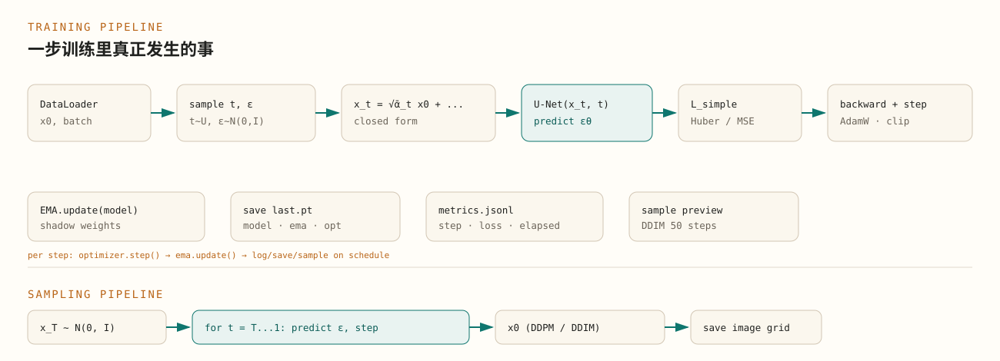
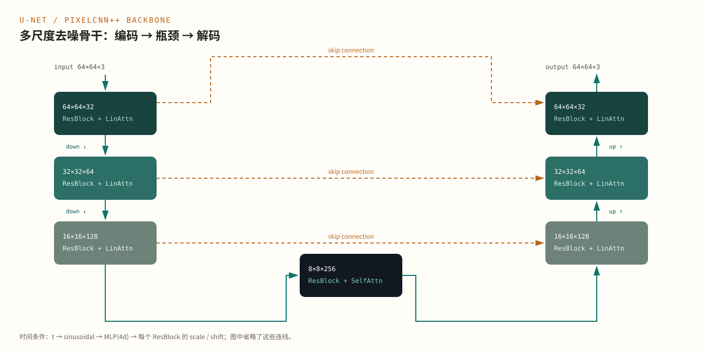

<div class="abstract-card">
<p class="abstract-label">Abstract / 导读</p>
<p>数学篇回答“为什么能生成”，工程篇回答“怎样把它稳定地训练出来、采样出来、复现出来”。本文以 <code>code/DDPM</code> 的实现为线索，拆解 U-Net 的每个块、时间条件、注意力、损失与优化、数据管线、EMA、检查点和 DDIM 加速，并列出实际调参时最容易踩的数值与性能陷阱。DDPM 的完整数学推导见<a href="../ddpm-math/index.html">《DDPM 的数学原理》</a>，本文不重复。</p>
<div class="keywords"><span>U-Net</span><span>EMA</span><span>DDIM</span><span>混合精度</span><span>检查点</span></div>
</div>

## 导读：公式之外的工程问题 {#overview}

把 DDPM 写成公式只需要几行，把它做成一个能训练、能复现、能在 CPU 上跑通的系统，需要回答另一组问题：

- 网络应该长什么样？为什么是 U-Net，而不是普通 CNN？
- 时间步 $t$ 怎样进入网络？为什么不能只把它拼到输入上？
- 损失用 L1、L2 还是 Huber？梯度要不要裁剪？
- 为什么需要 EMA？EMA 和原始权重什么时候用哪个？
- 检查点里应该存什么，才能断点续训、又能直接采样？
- 1000 步 DDPM 太慢，DDIM 为什么能 50 步？代价是什么？
- 哪些数值操作会在 $t$ 接近 $0$ 或 $T$ 时爆炸？

本文按训练和采样的真实数据流展开，并把这些选择和代码里的模块一一对应。

## 总体管线 {#pipeline}

一次训练 step 和一次采样，是两条方向相反、但共享同一个 U-Net 的流水线。

<figure class="article-figure figure--wide" id="fig-pipeline">
<a class="zoom-link" href="images/pipeline.svg" data-caption="DDPM 的训练流水线与采样流水线。">

</a>
<figcaption><span class="fig-no">图 1</span>训练时随机采样 $t$ 和 $\boldsymbol{\epsilon}$，一次前向就能得到监督信号；采样时从 $\mathbf{x}_T$ 开始，反复调用同一个 U-Net。EMA、检查点、日志和预览是训练侧的旁路。<span class="fig-source">笔记重绘</span></figcaption>
</figure>

训练 step 的核心只有几行：

```python
timesteps = torch.randint(
    0, diffusion.timesteps, (images.shape[0],), device=device, dtype=torch.long
)
loss = diffusion.p_losses(model, images, timesteps)

optimizer.zero_grad(set_to_none=True)
loss.backward()
torch.nn.utils.clip_grad_norm_(model.parameters(), 1.0)
optimizer.step()
ema.update(model)
```

对应 `src/dppm/train.py` 的训练循环。注意这里**没有**显式构造 $\mathbf{x}_t$：它藏在 `p_losses` 内部，由 `q_sample` 用闭式完成。这样每个 step 只需要一次网络前向和一次反向，不需要展开 $T$ 步。

采样则是：

```python
image = torch.randn(shape, device=device)
for t_index in reversed(range(diffusion.timesteps)):
    t = torch.full((shape[0],), t_index, device=device, dtype=torch.long)
    image = diffusion.p_sample(model, image, t, t_index)
```

DDIM 版本只遍历一个子序列，见后文。

## U-Net 结构 {#unet}

DDPM 的骨干不是“任意 CNN”，而是一个带时间条件、带跳跃连接、多分辨率的 U-Net。它要同时完成两件事：

1. 在不同尺度上识别“哪些是信号、哪些是噪声”；
2. 根据当前噪声级别 $t$，决定去噪的力度。

<figure class="article-figure figure--wide" id="fig-unet">
<a class="zoom-link" href="images/unet.svg" data-caption="DDPM U-Net 的编码器、瓶颈、解码器与跳跃连接。">

</a>
<figcaption><span class="fig-no">图 2</span>U-Net 的编码器—瓶颈—解码器结构。每个分辨率级包含残差块与注意力；跳跃连接把编码器的细节直接送到解码器。图中以 64×64 输入、四级通道倍数为例。<span class="fig-source">笔记重绘</span></figcaption>
</figure>

以 `dim=32, dim_mults=(1,2,4,8)`、64×64 输入为例：

| 阶段 | 分辨率 | 通道 | 主要操作 |
|---|---|---|---|
| 输入 | 64×64 | 3 | 1×1 卷积升维 |
| 编码 L1 | 64×64 | 32 | ResBlock ×2 + LinearAttention |
| 编码 L2 | 32×32 | 64 | ResBlock ×2 + LinearAttention |
| 编码 L3 | 16×16 | 128 | ResBlock ×2 + LinearAttention |
| 瓶颈 | 8×8 | 256 | ResBlock ×2 + SelfAttention |
| 解码 L3 | 16×16 | 128 | 拼接 skip + ResBlock ×2 |
| 解码 L2 | 32×32 | 64 | 拼接 skip + ResBlock ×2 |
| 解码 L1 | 64×64 | 32 | 拼接 skip + ResBlock ×2 |
| 输出 | 64×64 | 3 | 1×1 卷积 |

默认的 `dim_mults=(1,2,4)` 少一级下采样，瓶颈在 16×16；图里展示的是博客/论文常用的四级配置。两者结构相同，只是级数不同。

### 残差块与条件归一化

每个 `ResnetBlock` 由两个 `Block` 组成，每个 `Block` 是：

```text
weight-standardized 3×3 conv → GroupNorm → 可选 scale/shift → SiLU
```

GroupNorm 不依赖 batch 大小，特别适合 DDPM 这种 batch 可能很小、又不想让归一化统计量随 batch 波动的场景。U-Net 里没有 BatchNorm，因此训练和采样的行为一致，也不需要维护 running statistics。

残差连接保证深层网络仍然容易优化：

```python
h = self.block1(x, scale_shift=scale_shift)
h = self.block2(h)
return h + self.res_conv(x)
```

### 权重标准化

普通卷积的权重直接参与卷积；weight-standardized conv 先对每个输出通道的权重做标准化：

$$
\hat{\mathbf{w}}_o
=
\frac{\mathbf{w}_o-\mu_o}{\sqrt{\sigma_o^2+\epsilon}}
$$

然后再做卷积。它起到类似 BatchNorm 的“稳定尺度”作用，但**不依赖 batch 统计**，也不会在训练/采样之间产生行为差异。实现里对每个输出通道在 `(in_channels, kH, kW)` 上求均值和方差，`eps` 防止除零。

### 下采样与上采样

编码器用 2×2 像素重排（space-to-depth）加 1×1 卷积做下采样，而不是 stride-2 卷积：

```python
Rearrange("b c (h p1) (w p2) -> b (c p1 p2) h w", p1=2, p2=2)
Conv2d(dim * 4, dim_out, 1)
```

这样下采样没有重叠、没有额外的平滑，信息损失更可控。解码器用最近邻上采样加 3×3 卷积；简单、稳定，也不会产生棋盘格伪影。

## 时间条件 {#time}

同一个 U-Net 要在 $t=1$ 和 $t=1000$ 执行完全不同的去噪任务。时间 $t$ 必须进入网络的每一层，而不是只在输入端拼一个标量。

DDPM 使用正弦位置嵌入：

$$
\mathrm{emb}(t)_i=
\begin{cases}
\sin(\omega_i t), & i < d/2\\
\cos(\omega_i t), & i \ge d/2
\end{cases},
\qquad
\omega_i=\exp\left(-\frac{\log 10000}{d/2-1}i\right)
$$

然后过一个两层 MLP：

```python
self.time_mlp = nn.Sequential(
    SinusoidalPositionEmbeddings(dim),
    nn.Linear(dim, dim * 4),
    nn.GELU(),
    nn.Linear(dim * 4, dim * 4),
)
```

得到的 `time_emb` 在每个 ResBlock 里被映射成两组通道数相同的向量，用于仿射变换：

```python
time_emb = self.mlp(time_emb)[:, :, None, None]
scale, shift = time_emb.chunk(2, dim=1)
h = self.block1(x, scale_shift=(scale, shift))
```

也就是：

$$
h \leftarrow h \odot (1+\mathrm{scale})+\mathrm{shift}
$$

这比“把 $t$ 拼到图像通道上”更有效：它直接调制每个残差块的归一化后激活，让不同噪声级别可以复用同一套卷积权重，只改变“去噪强度”。

## 注意力与内存 {#attention}

U-Net 在高分辨率层使用**线性注意力**，在瓶颈使用**完整自注意力**。这是显存和表达力的折中。

- 完整自注意力：$N=H\times W$ 个位置两两计算，复杂度 $O(N^2)$；
- 线性注意力：用核技巧把注意力写成全局上下文，复杂度 $O(N)$。

在 64×64 输入、16×16 特征图上，$N=256$，完整注意力还可接受；到 64×64 的 $N=4096$，$N^2$ 会迅速吃满显存。因此：

- 编码/解码的高分辨率层：`LinearAttention`；
- 中间的 8×8 或 16×16 瓶颈：`Attention`；
- 每个注意力都包在 `PreNorm` + `Residual` 里，保证稳定。

代码在 `src/dppm/model/attention.py`。如果显存不足，优先减少高分辨率层的通道数或注意力头数，而不是直接去掉所有注意力。

## 损失、优化与稳定性 {#optimization}

### 损失函数

数学篇式 (13) 是均方误差。工程实现通常提供 L1、L2、Huber 三种：

```python
if loss_type == "l1":
    return F.l1_loss(noise, predicted_noise)
if loss_type == "l2":
    return F.mse_loss(noise, predicted_noise)
if loss_type == "huber":
    return F.smooth_l1_loss(noise, predicted_noise)
```

Huber 在误差较小时近似 L2、误差较大时近似 L1，对异常值和训练早期的大误差更稳健。博客和本实现默认使用 Huber；如果数据干净、训练稳定，L2 也完全可用。

### 梯度裁剪

DDPM 的训练损失在 $t$ 很大时可能更大，早期梯度尺度不稳定。默认裁剪：

```python
torch.nn.utils.clip_grad_norm_(model.parameters(), 1.0)
```

这不是 DDPM 数学的一部分，而是深度网络训练的常规稳定化手段。裁剪阈值太大等于没裁，太小会让学习变慢；1.0 是一个安全的起点。

### 优化器与学习率

博客使用 AdamW、学习率 $2\times10^{-4}$。DDPM 对学习率比较敏感：太大容易在早期出现噪声预测的震荡，太小则收敛慢。CPU 小模型可以先用 `2e-4`；如果 loss 长期不降，先检查数据范围和损失类型，再考虑调学习率。

### 混合精度

GPU 上可以用 `torch.autocast` + `GradScaler` 把大部分矩阵运算放到 fp16/bf16，显著减少显存、提高吞吐。CPU 默认仍是 fp32；部分 CPU 支持 bfloat16，但收益依硬件而定，不建议作为默认。

当前 `code/DDPM` 为了 CPU 可复现性，默认不启用 AMP。若迁移到 GPU，建议：

```python
scaler = torch.amp.GradScaler("cuda")
with torch.autocast("cuda", dtype=torch.bfloat16):
    loss = diffusion.p_losses(model, images, timesteps)
scaler.scale(loss).backward()
scaler.step(optimizer)
scaler.update()
```

注意：AMP 只改变计算精度，不改变噪声调度；采样时通常也用 autocast，但要确保 `sqrt`、`exp` 等操作在稳定范围内。

## 数据管线 {#data}

DDPM 对数据范围很敏感。前向过程假设数据大致零中心、单位方差，逆向过程从标准高斯出发，因此训练图像通常缩放到 $[-1,1]$：

```python
transforms.Compose([
    transforms.Resize(image_size, antialias=True),
    transforms.CenterCrop(image_size),
    transforms.RandomHorizontalFlip(),
    transforms.ToTensor(),
    transforms.Normalize([0.5] * channels, [0.5] * channels),
])
```

`ToTensor` 把 PIL 图像变成 $[0,1]$，`Normalize(0.5, 0.5)` 再映射到 $[-1,1]$。如果这里用了 ImageNet 均值方差，或者忘记归一化，模型会学到错误的噪声尺度，表现为采样发灰、对比度异常或完全失败。

本实现支持四种数据源：

| 数据源 | 参数 | 说明 |
|---|---|---|
| 合成形状 | `--source synthetic` | 无需下载，适合烟雾测试 |
| 本地图片 | `--source imagefolder --data-dir ...` | 每个子目录一类 |
| CIFAR-10 | `--source cifar10 --cifar-root data` | 可用 `--download` |
| HuggingFace | `--source hf --hf-dataset ...` | 需要 `datasets`，可指定图像列名 |

CPU 默认 `num_workers=0`，避免多进程开销；GPU 或大数据集可以增大。`DataLoader` 使用固定 `generator`，配合 `set_seed` 保证可复现。数据增强只做水平翻转；DDPM 对几何变换比较敏感，复杂的颜色抖动、裁剪会改变噪声分布。

## EMA 与检查点 {#ema}

### 为什么需要 EMA

DDPM 的采样对权重扰动很敏感。训练后期的单步权重可能在某批数据上波动，直接用最后一步的权重采样，样本质量可能不如“最近一段时间权重的平均”。

EMA 维护一份影子权重：

$$
\theta_{\mathrm{ema}}
\leftarrow
\beta\,\theta_{\mathrm{ema}}
+(1-\beta)\,\theta
\tag{1}
$$

`beta=0.9999` 时，有效平均窗口约 $1/(1-\beta)=10000$ 步。训练步数很少时，EMA 会严重滞后于当前模型，此时可以降低 `beta` 或关闭 EMA；本仓库的烟雾测试用 `0.9`，只是为了让两步训练也能产生有效预览。

```python
for ema_parameter, parameter in zip(self.model.parameters(), model.parameters()):
    ema_parameter.mul_(self.beta).add_(
        parameter.detach(), alpha=1.0 - self.beta
    )
```

采样时优先用 EMA 权重；训练日志里也可以同时记录原始模型和 EMA 模型的预览，判断 EMA 是否真的带来提升。

### 检查点里应该有什么

一个可续训、可直接采样的检查点至少包含：

- `model`：U-Net 权重；
- `ema`：EMA 影子权重（可选）；
- `optimizer`：优化器状态；
- `model_config` / `diffusion_config` / `data_config`：重建模型和采样所需配置；
- `epoch` / `step`：续训位置；
- `format`：检查点版本。

只保存 `model.state_dict()` 是不够的：采样时不知道 `dim_mults`、图像尺寸、噪声调度，就无法重建网络和扩散过程。`sample.py` 会从检查点读取这些配置，而不是要求用户重新输入。

检查点通过 `torch.load(..., weights_only=False)` 读取，因为里面包含配置字典。**只加载自己信任的检查点**；不要加载来源不明的 `.pt` 文件。

## 采样加速：DDPM 与 DDIM {#sampling}

DDPM 的祖先采样需要 $T$ 次网络前向。默认 $T=1000$，在 CPU 上很慢；即使 GPU，1000 步也是明显的延迟。

DDIM 的核心是：不要求逆向过程必须是马尔可夫链，而是构造一条与训练目标一致的确定性（或半随机）轨迹。它只取 $T$ 步中的一个子序列：

$$
\mathbf{x}_{t-1}
=
\sqrt{\bar\alpha_{t-1}}\,\hat{\mathbf{x}}_0
+
\sqrt{1-\bar\alpha_{t-1}-\sigma_t^2}\,\boldsymbol{\epsilon}_\theta
+
\sigma_t\mathbf{z}
\tag{2}
$$

其中

$$
\hat{\mathbf{x}}_0
=
\frac{\mathbf{x}_t-\sqrt{1-\bar\alpha_t}\,\boldsymbol{\epsilon}_\theta}
{\sqrt{\bar\alpha_t}}
$$

当 $\sigma_t=0$ 时，采样完全确定；给定同一个 $\mathbf{x}_T$，输出固定。`eta` 控制随机性，`eta=0` 是最常用的确定性 DDIM。

```python
times = torch.linspace(0, timesteps - 1, steps).round().long().unique()
times = times.sort(descending=True).values

for position, current in enumerate(times):
    eps = model(image, t_tensor)
    x0 = (image - sqrt(1 - ab_t) * eps) / sqrt(ab_t)
    x0 = x0.clamp(-1.0, 1.0)
    image = sqrt(ab_prev) * x0 + sqrt(1 - ab_prev) * eps
```

| 采样器 | 网络前向次数 | 随机性 | 适用场景 |
|---|---|---|---|
| DDPM | $T$（默认 1000） | 每步注入噪声 | 论文算法复现、质量优先 |
| DDIM | 可配置（默认 50） | `eta=0` 时确定 | CPU 推理、快速预览、批量生成 |

DDIM 不是“免费加速”：步数太少时，离散化误差变大，细节会损失；50 步通常是质量和速度的折中，10–20 步适合预览。无论 DDPM 还是 DDIM，**不同初始噪声仍然产生不同样本**；确定性只表示“同一初始噪声对应同一输出”。

## 数值与性能陷阱 {#pitfalls}

1. **$t=0$ 的数值边界**：后验方差在 $t=0$ 为 $0$，最后一步直接返回均值、不再加噪声；同时 $\sqrt{1-\bar\alpha_t}$ 很小，注意不要在这里引入无意义的除零或放大误差。
2. **数据范围**：训练用 $[-1,1]$，保存时映射回 $[0,1]$；如果训练用 $[0,1]$，噪声尺度和输出范围都会错。
3. **调度不一致**：训练和采样必须使用同一个 `beta` 调度、同一个 $T$。检查点里保存配置，采样时不要用命令行默认值覆盖。
4. **过度裁剪 $\hat{\mathbf{x}}_0$**：DDIM 中把 $\hat{\mathbf{x}}_0$ 裁到 $[-1,1]$ 可以稳定训练/采样，但会引入偏差；如果发现颜色饱和，尝试关闭或放宽裁剪。
5. **BatchNorm**：不要用 BatchNorm。小 batch 下统计量噪声大，训练/采样行为不一致；GroupNorm 更合适。
6. **注意力显存**：高分辨率用完整自注意力会 $O(N^2)$ 爆炸；用线性注意力，或把完整注意力限制在瓶颈。
7. **EMA 滞后**：训练步数少于平均窗口时，EMA 可能几乎没更新；短训练要降低 `beta`。
8. **检查点配置漂移**：续训时模型/扩散配置必须与检查点一致，否则加载权重会报错或产生错误结果。
9. **CPU 线程/worker 过度订阅**：`num_workers` 过大、`torch` 线程数过多会互相争抢；CPU 先用 `num_workers=0`。
10. **`torch.load` 安全**：只加载可信检查点；不要把用户上传的 `.pt` 直接当配置读取。

## 代码地图与复现 {#code-map}

| 模块 | 职责 |
|---|---|
| `src/dppm/config.py` | 配置 dataclass、参数校验、JSON 序列化 |
| `src/dppm/data.py` | 合成数据、ImageFolder、CIFAR-10、HuggingFace、变换 |
| `src/dppm/model/blocks.py` | 残差、上下采样、时间嵌入、weight-standardized conv |
| `src/dppm/model/attention.py` | 完整/线性注意力、PreNorm |
| `src/dppm/model/unet.py` | U-Net 组装与前向 |
| `src/dppm/diffusion.py` | 前向、损失、DDPM/DDIM 采样 |
| `src/dppm/ema.py` | 权重 EMA |
| `src/dppm/train.py` | 训练循环、日志、检查点、预览 |
| `src/dppm/sample.py` | 检查点加载与图片生成 |
| `src/dppm/cli.py` | `train / sample / inspect / smoke` |

最小复现：

```bash
cd code/DDPM
uv sync
source .venv/bin/activate
dppm smoke --output-dir runs/smoke
```

`smoke` 用 32×32、`dim=16`、`dim_mults=(1,2)`、2 步训练和 2 步 DDIM，验证整条链路，而不是验证生成质量。默认 64×64 模型约 260 万参数，CPU 上可以训练小数据集；完整 Flowers/CIFAR 训练需要更长时间。

## 进一步优化 {#next}

按收益/成本排序，可以考虑：

- **GPU + AMP**：最直接的吞吐提升；注意用 `GradScaler`，并在采样时保持数值稳定。
- **DDIM / DPM-Solver**：减少采样步数，尤其适合 CPU 或交互式预览。
- **`torch.compile`**：对固定形状的 U-Net 可能有帮助，但首次编译和 CPU 收益因环境而异；先测再开。
- **`channels_last`**：GPU 上卷积更友好；CPU 收益通常有限。
- **梯度累积**：显存不足时模拟更大 batch；注意 EMA 更新频率和学习率缩放。
- **激活检查点**：高分辨率/深 U-Net 训练时用计算换显存。
- **Latent Diffusion**：把扩散搬到 VAE 潜空间，是高清生成的主流路线；本质仍是本文的 DDPM，只是数据空间换了。
- **条件生成**：类别嵌入、文本 cross-attention、ControlNet；这会把“随机采样”变成“按需求生成”，但需要额外数据和结构。

不要在数据、调度和损失还没对齐时就开始堆优化。DDPM 的很多“训练不收敛”其实是数据范围、噪声调度或检查点配置的问题。

## 小结 {#summary}

- **U-Net** 提供多尺度去噪能力；时间嵌入让同一套权重适配不同噪声级别。
- **GroupNorm + 权重标准化** 让训练不依赖 batch 统计；**线性注意力**控制高分辨率显存。
- **Huber/MSE + 梯度裁剪 + AdamW** 是稳定训练的基本组合；**EMA** 提升采样质量。
- **检查点**必须保存模型、EMA、优化器和三份配置，才能可靠续训和采样。
- **DDIM** 用更少步数近似同一条生成轨迹；`eta=0` 时确定性，适合 CPU。
- 数值上最需要小心的是数据范围、$t=0$ 的除法、调度一致性和注意力显存。

## 延伸阅读 {#further-reading}

- **数学篇**：[DDPM 的数学原理](../ddpm-math/index.html)。前向、后验、ELBO、score 与采样的完整推导。
- **译文**：[去噪扩散概率模型（DDPM）](../ddpm/index.html)。论文正文与实验。
- **DDIM**：[Denoising Diffusion Implicit Models](https://arxiv.org/abs/2010.02502)（Song 等，2021）。
- **Improved DDPM**：[Improved Denoising Diffusion Probabilistic Models](https://arxiv.org/abs/2102.09672)（Nichol & Dhariwal，2021）。
- **Latent Diffusion**：[High-Resolution Image Synthesis with Latent Diffusion Models](https://arxiv.org/abs/2112.10752)（Rombach 等，2022）。
- **代码**：本仓库的 `code/DDPM`，包含本文讨论的全部模块和 CLI。
