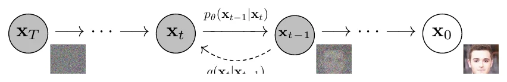
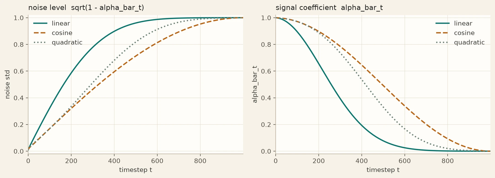
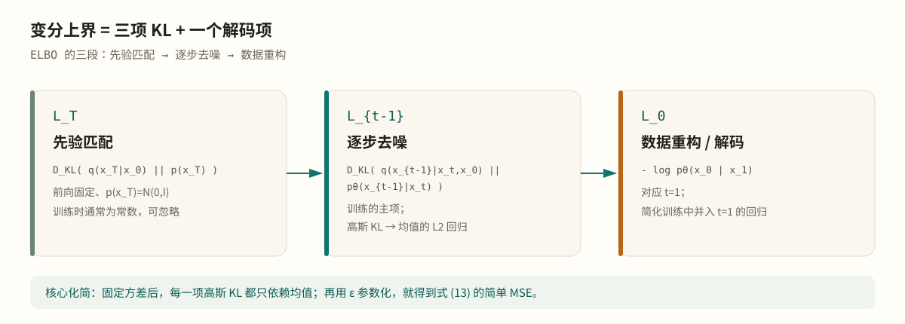

Abstract / 导读

DDPM 的核心并不是“训练一个网络直接画图”，而是把生成问题改写成一条<strong>从数据到噪声、再从噪声回到数据</strong>的概率链。前向过程固定、可解；逆向过程用神经网络近似；训练目标来自变分下界；最终的学习信号可以化简成“预测每一步加入的噪声”。本文按“前向 → 后验 → ELBO → 噪声回归 → score → 采样”的顺序，把这套数学完整拆开。

变分推断高斯链ELBOε-预测score matching

## 生成问题：为什么要一条链 {#overview}

我们有一批来自未知分布 $p_{\mathrm{data}}(\mathbf{x}_0)$ 的图像 $\mathbf{x}_0$，想学一个模型 $p_\theta(\mathbf{x}_0)$，使它能够采样出类似的数据。

DDPM 引入一组与图像同维的潜变量

$$
\mathbf{x}_1,\mathbf{x}_2,\ldots,\mathbf{x}_T
$$

并定义两条链：

- **前向过程** $q(\mathbf{x}_{1:T}\mid\mathbf{x}_0)$：固定不变，逐步向图像加高斯噪声；
- **逆向过程** $p_\theta(\mathbf{x}_{0:T})$：带参数，学习从噪声逐步去噪。

前向过程把复杂的数据分布逐渐抹平成简单的标准高斯；逆向过程则试图沿着相反方向，把标准高斯推回数据分布。生成模型就是逆向过程：

$$
p_\theta(\mathbf{x}_{0:T}) := p(\mathbf{x}_T)\prod_{t=1}^{T}p_\theta(\mathbf{x}_{t-1}\mid\mathbf{x}_t),
\qquad
p(\mathbf{x}_T)=\mathcal{N}(\mathbf{0},\mathbf{I})
$$

训练目标是让 $p_\theta(\mathbf{x}_0)$ 尽量接近 $p_{\mathrm{data}}(\mathbf{x}_0)$；但直接最大化 $\log p_\theta(\mathbf{x}_0)$ 需要对所有潜变量积分，无法直接计算。于是我们用变分推断，优化一个可计算的上界。

## 前向过程：一条线性高斯链 {#forward}

定义噪声强度 $\beta_1,\ldots,\beta_T\in(0,1)$，并记

$$
\alpha_t := 1-\beta_t,
\qquad
\bar\alpha_t := \prod_{s=1}^{t}\alpha_s
$$

前向一步是

$$
q(\mathbf{x}_t\mid\mathbf{x}_{t-1})
= \mathcal{N}\left(\mathbf{x}_t;\sqrt{1-\beta_t}\,\mathbf{x}_{t-1},\beta_t\mathbf{I}\right)
\tag{1}
$$

也就是

$$
\mathbf{x}_t = \sqrt{\alpha_t}\,\mathbf{x}_{t-1} + \sqrt{\beta_t}\,\boldsymbol{\epsilon}_t,
\qquad
\boldsymbol{\epsilon}_t\sim\mathcal{N}(\mathbf{0},\mathbf{I})
$$

这里乘 $\sqrt{\alpha_t}$ 是为了让方差大致保持不变：如果 $\mathbf{x}_{t-1}$ 的各坐标近似单位方差，那么 $\mathbf{x}_t$ 的方差也近似为 $1$。

由于每一步都是线性高斯的，整条链可以“跳步”采样。把上式反复展开，得到闭式：

$$
q(\mathbf{x}_t\mid\mathbf{x}_0)
= \mathcal{N}\left(\mathbf{x}_t;\sqrt{\bar\alpha_t}\,\mathbf{x}_0,(1-\bar\alpha_t)\mathbf{I}\right)
\tag{2}
$$

等价地：

$$
\mathbf{x}_t = \sqrt{\bar\alpha_t}\,\mathbf{x}_0 + \sqrt{1-\bar\alpha_t}\,\boldsymbol{\epsilon},
\qquad
\boldsymbol{\epsilon}\sim\mathcal{N}(\mathbf{0},\mathbf{I})
$$

这个式子非常重要：它说明**任意噪声级别的 $\mathbf{x}_t$ 都可以由原图 $\mathbf{x}_0$ 和一个标准高斯噪声直接构造**，不需要真的跑 $t$ 步前向。

当 $t$ 很小时，$\bar\alpha_t\approx1$，$\mathbf{x}_t$ 仍然很像原图；当 $t$ 接近 $T$ 时，$\bar\alpha_T\approx0$，$\mathbf{x}_T$ 近似纯噪声。噪声调度决定了这个“破坏”过程有多快。

<figure class="article-figure figure--diagram" id="fig-forward-reverse">

<figcaption>图 1前向过程 $q(\mathbf{x}_t\mid\mathbf{x}_{t-1})$ 与逆向过程 $p_\theta(\mathbf{x}_{t-1}\mid\mathbf{x}_t)$ 的有向图模型。DDPM 论文，图 2</figcaption>
</figure>

<figure class="article-figure figure--wide" id="fig-schedule">

<figcaption>图 2常见噪声调度下的噪声标准差 $\sqrt{1-\bar\alpha_t}$ 与信号系数 $\bar\alpha_t$。线性调度在中段衰减更快；余弦调度在两端更平滑。笔记重绘</figcaption>
</figure>

前向过程没有任何可学习参数。这个选择不是偷懒，而是整个方法可解的前提：后验、ELBO、训练目标都依赖于前向过程是已知的线性高斯链。

## 逆向过程与后验 {#posterior}

逆向过程定义为

$$
p_\theta(\mathbf{x}_{t-1}\mid\mathbf{x}_t)
= \mathcal{N}\left(\mathbf{x}_{t-1};\boldsymbol{\mu}_\theta(\mathbf{x}_t,t),\boldsymbol{\Sigma}_\theta(\mathbf{x}_t,t)\right)
\tag{3}
$$

在 DDPM 中，协方差通常固定为 $\sigma_t^2\mathbf{I}$，网络只学习均值 $\boldsymbol{\mu}_\theta$。为什么可以只学均值？因为当我们把逆向一步写成“从 $p_\theta$ 中采样”时，训练目标最终主要约束均值；固定方差已经能取得很好的样本质量，学习方差还会增加不稳定性。

### 后验到底在说什么

“后验”是给定观测后，隐变量的条件分布。这里我们真正需要的单步后验是

$$
q(\mathbf{x}_{t-1}\mid\mathbf{x}_t,\mathbf{x}_0)
$$

翻成人话：

> 已知干净原图 $\mathbf{x}_0$，又已知第 $t$ 步的带噪图 $\mathbf{x}_t$，那么中间那张 $\mathbf{x}_{t-1}$ 应该是什么样？

它不是确定值，而是一个分布：从 $\mathbf{x}_0$ 到 $\mathbf{x}_t$ 的加噪路径不唯一，$\mathbf{x}_{t-1}$ 有多个可能。

### 为什么可解

由贝叶斯公式：

$$
q(\mathbf{x}_{t-1}\mid\mathbf{x}_t,\mathbf{x}_0)
\propto
q(\mathbf{x}_t\mid\mathbf{x}_{t-1})\,q(\mathbf{x}_{t-1}\mid\mathbf{x}_0)
$$

右边两项都是高斯：

- $q(\mathbf{x}_t\mid\mathbf{x}_{t-1})=\mathcal{N}(\sqrt{\alpha_t}\mathbf{x}_{t-1},\beta_t\mathbf{I})$；
- $q(\mathbf{x}_{t-1}\mid\mathbf{x}_0)=\mathcal{N}(\sqrt{\bar\alpha_{t-1}}\mathbf{x}_0,(1-\bar\alpha_{t-1})\mathbf{I})$。

两个高斯相乘，结果仍是高斯。配方后得到：

$$
q(\mathbf{x}_{t-1}\mid\mathbf{x}_t,\mathbf{x}_0)
= \mathcal{N}\left(\mathbf{x}_{t-1};\tilde{\boldsymbol{\mu}}_t(\mathbf{x}_t,\mathbf{x}_0),\tilde\beta_t\mathbf{I}\right)
\tag{4}
$$

其中

$$
\tilde{\boldsymbol{\mu}}_t(\mathbf{x}_t,\mathbf{x}_0)
= \frac{\sqrt{\bar\alpha_{t-1}}\beta_t}{1-\bar\alpha_t}\mathbf{x}_0
+ \frac{\sqrt{\alpha_t}(1-\bar\alpha_{t-1})}{1-\bar\alpha_t}\mathbf{x}_t
\tag{5}
$$

$$
\tilde\beta_t
= \frac{1-\bar\alpha_{t-1}}{1-\bar\alpha_t}\beta_t
\tag{6}
$$

### 直觉：两个高斯线索的精度加权

把后验均值理解成两个“线索”的加权融合：

- 从 $\mathbf{x}_t$ 倒推：$\mathbf{x}_t=\sqrt{\alpha_t}\mathbf{x}_{t-1}+\text{噪声}$，所以 $\mathbf{x}_{t-1}\approx\mathbf{x}_t/\sqrt{\alpha_t}$，方差 $\beta_t/\alpha_t$，精度 $\alpha_t/\beta_t$；
- 从 $\mathbf{x}_0$ 前推：$\mathbf{x}_{t-1}=\sqrt{\bar\alpha_{t-1}}\mathbf{x}_0+\text{噪声}$，方差 $1-\bar\alpha_{t-1}$，精度 $1/(1-\bar\alpha_{t-1})$。

后验的精度是两个精度之和：

$$
A=\frac{\alpha_t}{\beta_t}+\frac{1}{1-\bar\alpha_{t-1}}
=\frac{1-\bar\alpha_t}{\beta_t(1-\bar\alpha_{t-1})}
$$

所以方差为

$$
\tilde\beta_t=\frac{1}{A}
=\frac{\beta_t(1-\bar\alpha_{t-1})}{1-\bar\alpha_t}
$$

均值为“精度 × 估计”的加权平均，化简后正是式 (5)。这解释了那些看起来奇怪的系数：它们不是随手拼出来的，而是两个高斯信息源的精度权重。

### 一个具体数字例子

取 $\beta=0.1$，所以 $\alpha=0.9$；$\bar\alpha_1=0.9$，$\bar\alpha_2=0.81$。假设 $\mathbf{x}_0=0$，观测到 $\mathbf{x}_2=0.5$。代入 $t=2$：

$$
\tilde{\boldsymbol{\mu}}_2
\approx 0.499\cdot 0+0.499\cdot0.5
\approx0.25
$$

方差约为 $0.053$，标准差约 $0.23$。也就是说，知道路径的起点和终点后，中间点最可能在 $0.25$ 附近，但仍有一个不确定范围。到了 $t=1$，后验直接退化成 $\mathbf{x}_0$，方差为 $0$。

### 采样时没有 $\mathbf{x}_0$

后验公式需要 $\mathbf{x}_0$，但生成时没有原图。于是用网络从 $\mathbf{x}_t$ 估计 $\mathbf{x}_0$。由式 (2)：

$$
\mathbf{x}_0
= \frac{\mathbf{x}_t-\sqrt{1-\bar\alpha_t}\,\boldsymbol{\epsilon}}{\sqrt{\bar\alpha_t}}
\tag{7}
$$

如果把 $\boldsymbol{\epsilon}$ 换成网络预测的 $\boldsymbol{\epsilon}_\theta(\mathbf{x}_t,t)$，再代回式 (5)，就得到实际使用的逆向均值：

$$
\boldsymbol{\mu}_\theta(\mathbf{x}_t,t)
= \frac{1}{\sqrt{\alpha_t}}\left(
\mathbf{x}_t-\frac{\beta_t}{\sqrt{1-\bar\alpha_t}}\boldsymbol{\epsilon}_\theta(\mathbf{x}_t,t)
\right)
\tag{8}
$$

这一步是整个 DDPM 的核心：**训练时用真实 $\mathbf{x}_0$ 定义后验；采样时用网络估计的 $\mathbf{x}_0$ 代替。**

## 变分上界：把生成写成可优化问题 {#elbo}

直接最大化 $\log p_\theta(\mathbf{x}_0)$ 需要对 $\mathbf{x}_{1:T}$ 积分。变分推断给出一个可计算的上界：

$$
-\log p_\theta(\mathbf{x}_0)
\le
\mathbb{E}_q\left[
-\log\frac{p_\theta(\mathbf{x}_{0:T})}{q(\mathbf{x}_{1:T}\mid\mathbf{x}_0)}
\right]
=:L
\tag{9}
$$

把联合分布和近似后验都按马尔可夫链展开，并利用贝叶斯公式，可以把 $L$ 拆成三项：

$$
L=L_T+\sum_{t>1}L_{t-1}+L_0
\tag{10}
$$

其中

$$
L_T=D_{\mathrm{KL}}\left(q(\mathbf{x}_T\mid\mathbf{x}_0)\,\|\,p(\mathbf{x}_T)\right)
$$

$$
L_{t-1}=D_{\mathrm{KL}}\left(
q(\mathbf{x}_{t-1}\mid\mathbf{x}_t,\mathbf{x}_0)
\,\|\,p_\theta(\mathbf{x}_{t-1}\mid\mathbf{x}_t)
\right)
$$

$$
L_0=-\log p_\theta(\mathbf{x}_0\mid\mathbf{x}_1)
$$

三项的含义分别是：

- $L_T$：先验匹配。前向方差固定、$p(\mathbf{x}_T)=\mathcal{N}(\mathbf{0},\mathbf{I})$ 时，它是常数，训练时可以忽略；
- $L_{t-1}$：逐步去噪。它比较真实后验与网络逆向一步，是训练的主项；
- $L_0$：数据重构。对应最后一步从 $\mathbf{x}_1$ 解码到 $\mathbf{x}_0$，在简化目标里并入 $t=1$ 的回归项。

<figure class="article-figure figure--wide" id="fig-elbo">

<figcaption>图 3变分上界的三段结构。前向过程固定后，$L_T$ 是常数；真正训练网络的是中间的 KL 项与最后的解码项。笔记重绘</figcaption>
</figure>

## 从 KL 到噪声回归 {#loss}

在 $p_\theta$ 的方差固定为 $\sigma_t^2\mathbf{I}$ 时，$L_{t-1}$ 是两个高斯之间的 KL。高斯 KL 的公式告诉我们，它只依赖均值之差：

$$
L_{t-1}
=
\mathbb{E}_q\left[
\frac{1}{2\sigma_t^2}
\left\|
\tilde{\boldsymbol{\mu}}_t(\mathbf{x}_t,\mathbf{x}_0)
-\boldsymbol{\mu}_\theta(\mathbf{x}_t,t)
\right\|^2
\right]+C
\tag{11}
$$

其中 $C$ 与 $\theta$ 无关。于是训练网络就变成了“让预测均值接近真实后验均值”。

把式 (5) 和式 (7) 代入，并用

$$
\mathbf{x}_t=\sqrt{\bar\alpha_t}\mathbf{x}_0+\sqrt{1-\bar\alpha_t}\boldsymbol{\epsilon}
$$

重参数化，可以得到

$$
L_{t-1}
=
\mathbb{E}_{\mathbf{x}_0,\boldsymbol{\epsilon}}
\left[
\frac{\beta_t^2}{2\sigma_t^2\alpha_t(1-\bar\alpha_t)}
\left\|
\boldsymbol{\epsilon}
-\boldsymbol{\epsilon}_\theta(\mathbf{x}_t,t)
\right\|^2
\right]
\tag{12}
$$

这就是“预测噪声”的由来：均值之差经过代数化简后，正好变成噪声之差。

DDPM 进一步丢掉式 (12) 前面的权重，得到

$$
L_{\mathrm{simple}}(\theta)
=
\mathbb{E}_{t,\mathbf{x}_0,\boldsymbol{\epsilon}}
\left[
\left\|
\boldsymbol{\epsilon}
-\boldsymbol{\epsilon}_\theta
\left(
\sqrt{\bar\alpha_t}\mathbf{x}_0+\sqrt{1-\bar\alpha_t}\boldsymbol{\epsilon},t
\right)
\right\|^2
\right]
\tag{13}
$$

$t$ 在 $1,\ldots,T$ 中均匀采样。这个目标仍然是变分上界的一个加权版本，只是权重不同；实验上它训练的模型样本质量更好。直观原因是：式 (12) 的权重会压低小 $t$ 项，让网络把注意力放在噪声更大、去噪更困难的时间步上。

Algorithm 1 · 训练DDPM training

<ol>
<li>repeat</li>
<li>采样 $\mathbf{x}_0\sim q(\mathbf{x}_0)$</li>
<li>采样 $t\sim\mathrm{Uniform}(\{1,\ldots,T\})$</li>
<li>采样 $\boldsymbol{\epsilon}\sim\mathcal{N}(\mathbf{0},\mathbf{I})$</li>
<li>对以下目标做梯度下降：</li>
<li>$\nabla_\theta\left\|\boldsymbol{\epsilon}-\boldsymbol{\epsilon}_\theta(\sqrt{\bar\alpha_t}\mathbf{x}_0+\sqrt{1-\bar\alpha_t}\boldsymbol{\epsilon},t)\right\|^2$</li>
<li>until 收敛</li>
</ol>

## ε-预测就是 score matching {#score}

这一节解释“为什么预测噪声能生成图像”，而不只是“能重建噪声”。

对每个 $t$，加噪后的数据分布记作

$$
q_t(\mathbf{x}_t)=\int q(\mathbf{x}_t\mid\mathbf{x}_0)p_{\mathrm{data}}(\mathbf{x}_0)\,d\mathbf{x}_0
$$

它是原数据分布被高斯核平滑后的结果。定义 **score** 为对数密度的梯度：

$$
\nabla_{\mathbf{x}_t}\log q_t(\mathbf{x}_t)
$$

score 指向“概率更高的方向”。在加噪分布上，它告诉我们从当前带噪图像往哪里走，能更接近数据流形。

对单个 $\mathbf{x}_0$，条件 score 是

$$
\nabla_{\mathbf{x}_t}\log q(\mathbf{x}_t\mid\mathbf{x}_0)
=
-\frac{\boldsymbol{\epsilon}}{\sqrt{1-\bar\alpha_t}}
$$

边缘 score 是条件 score 的期望：

$$
\nabla_{\mathbf{x}_t}\log q_t(\mathbf{x}_t)
=
-\frac{\mathbb{E}[\boldsymbol{\epsilon}\mid\mathbf{x}_t]}{\sqrt{1-\bar\alpha_t}}
\tag{14}
$$

而式 (13) 的均方误差最优解，正是条件期望：

$$
\boldsymbol{\epsilon}_\theta(\mathbf{x}_t,t)
\approx
\mathbb{E}[\boldsymbol{\epsilon}\mid\mathbf{x}_t]
$$

代回式 (14)：

$$
\boldsymbol{\epsilon}_\theta(\mathbf{x}_t,t)
\approx
-\sqrt{1-\bar\alpha_t}\,
\nabla_{\mathbf{x}_t}\log q_t(\mathbf{x}_t)
\tag{15}
$$

所以**预测噪声 = 估计 score，只差一个与 $t$ 有关的缩放**。

由 Tweedie 公式，还可以从噪声预测直接得到条件均值：

$$
\mathbb{E}[\mathbf{x}_0\mid\mathbf{x}_t]
=
\frac{\mathbf{x}_t-\sqrt{1-\bar\alpha_t}\,\boldsymbol{\epsilon}_\theta(\mathbf{x}_t,t)}{\sqrt{\bar\alpha_t}}
\tag{16}
$$

这和式 (7) 完全一致。

在连续时间极限下，逆向过程可以写成随机微分方程：

$$
d\mathbf{x}
=
\left[
f(\mathbf{x},t)-g(t)^2\nabla_{\mathbf{x}}\log p_t(\mathbf{x})
\right]dt
+
g(t)\,d\bar{\mathbf{w}}
\tag{17}
$$

DDPM 的离散逆向链，就是对这个过程的近似。采样时沿着 score 走，本质上是在做退火的 Langevin 动力学：先在大噪声下确定粗结构，再在小噪声下补细节。

这也解释了为什么“预测噪声”不是目的：它是估计数据分布梯度的一种参数化方式。网络学的是一整个随 $t$ 变化的向量场，而不是某一张图。

## 采样：沿 score 走回数据 {#sampling}

有了 $\boldsymbol{\mu}_\theta$，逆向一步就是

$$
\mathbf{x}_{t-1}
=
\boldsymbol{\mu}_\theta(\mathbf{x}_t,t)
+
\sigma_t\mathbf{z},
\qquad
\mathbf{z}\sim\mathcal{N}(\mathbf{0},\mathbf{I})
\tag{18}
$$

其中 $\sigma_t^2$ 可以取 $\beta_t$，也可以取后验方差 $\tilde\beta_t$；DDPM 论文发现两者效果相近。$\mathbf{x}_0$ 的方差为 $0$，所以最后一步不再加噪声。

Algorithm 2 · 采样DDPM sampling

<ol>
<li>$\mathbf{x}_T\sim\mathcal{N}(\mathbf{0},\mathbf{I})$</li>
<li>for $t=T,\ldots,1$ do</li>
<li>$\mathbf{z}\sim\mathcal{N}(\mathbf{0},\mathbf{I})$，若 $t>1$；否则 $\mathbf{z}=\mathbf{0}$</li>
<li>$\mathbf{x}_{t-1}=\frac{1}{\sqrt{\alpha_t}}\left(\mathbf{x}_t-\frac{\beta_t}{\sqrt{1-\bar\alpha_t}}\boldsymbol{\epsilon}_\theta(\mathbf{x}_t,t)\right)+\sigma_t\mathbf{z}$</li>
<li>end for</li>
<li>return $\mathbf{x}_0$</li>
</ol>

这里每一步都保留随机性。这个随机项不是装饰：它让采样从条件后验中抽样，而不是只取条件均值；不同的 $\mathbf{x}_T$ 会走出不同轨迹，因此同一模型可以生成很多张不同的图。

DDIM 则去掉随机项，沿着一条确定性轨迹走，可以用更少的步数采样。它的更新式与式 (18) 不同，但目标相同：从噪声推进到数据分布。工程上的取舍见《DDPM 的工程实现》。

## 为什么有效，以及它不保证什么 {#limits}

### 为什么有效

- **分布传输**：前向过程把复杂数据分布变成简单高斯；逆向过程学习这个传输的逆。若网络完美，逆向链的边际分布就与真实数据分布一致。
- **从粗到细**：高噪声阶段 score 只包含大尺度结构，低噪声阶段才包含纹理细节；多步采样相当于不断细化。
- **不是查表**：训练覆盖所有 $\mathbf{x}_0$、$t$、$\boldsymbol{\epsilon}$，网络学的是条件期望/score 场，而不是某张训练图。
- **随机性带来多样性**：每步注入校准噪声，让采样覆盖分布，而不是塌缩到一个均值。

### 它不保证什么

- 无条件 DDPM **不保证**输出是某张“原来的图”。采样时没有原图输入，只有随机 $\mathbf{x}_T$；
- 它不保证生成用户想要的语义。没有类别、文本或参考图条件时，只能从训练数据所在的领域里随机采样；
- 它不保证小步数下质量不变。步数太少、调度不匹配、模型容量不足都会导致模糊或伪影；
- 如果从带噪原图出发，逆向过程会保留原图信息，这时才更接近“重建/修复”。

## 公式速查 {#cheatsheet}

<table class="paper-table">
<caption>表 1DDPM 的核心公式。</caption>
<thead><tr><th>概念</th><th>公式</th></tr></thead>
<tbody>
<tr><td>前向一步</td><td>$q(\mathbf{x}_t\mid\mathbf{x}_{t-1})=\mathcal{N}(\sqrt{\alpha_t}\mathbf{x}_{t-1},\beta_t\mathbf{I})$</td></tr>
<tr><td>闭式加噪</td><td>$\mathbf{x}_t=\sqrt{\bar\alpha_t}\mathbf{x}_0+\sqrt{1-\bar\alpha_t}\boldsymbol{\epsilon}$</td></tr>
<tr><td>单步后验</td><td>$q(\mathbf{x}_{t-1}\mid\mathbf{x}_t,\mathbf{x}_0)=\mathcal{N}(\tilde{\boldsymbol{\mu}}_t,\tilde\beta_t\mathbf{I})$</td></tr>
<tr><td>后验均值</td><td>$\tilde{\boldsymbol{\mu}}_t=\frac{\sqrt{\bar\alpha_{t-1}}\beta_t}{1-\bar\alpha_t}\mathbf{x}_0+\frac{\sqrt{\alpha_t}(1-\bar\alpha_{t-1})}{1-\bar\alpha_t}\mathbf{x}_t$</td></tr>
<tr><td>简化目标</td><td>$L_{\mathrm{simple}}=\mathbb{E}\|\boldsymbol{\epsilon}-\boldsymbol{\epsilon}_\theta(\mathbf{x}_t,t)\|^2$</td></tr>
<tr><td>噪声与 score</td><td>$\boldsymbol{\epsilon}_\theta\approx-\sqrt{1-\bar\alpha_t}\nabla\log q_t(\mathbf{x}_t)$</td></tr>
<tr><td>逆向均值</td><td>$\boldsymbol{\mu}_\theta=\frac{1}{\sqrt{\alpha_t}}\left(\mathbf{x}_t-\frac{\beta_t}{\sqrt{1-\bar\alpha_t}}\boldsymbol{\epsilon}_\theta\right)$</td></tr>
<tr><td>逆向采样</td><td>$\mathbf{x}_{t-1}=\boldsymbol{\mu}_\theta+\sigma_t\mathbf{z}$</td></tr>
</tbody>
</table>

## 延伸阅读 {#further-reading}

- **本库译文**：[去噪扩散概率模型（DDPM）](../ddpm/index.html)。正文、算法与实验表格的完整中文精译。
- **工程实现**：[DDPM 的工程实现](../ddpm-engineering/index.html)。U-Net、EMA、DDIM、检查点与性能优化。
- **DDPM 原始论文**：[Denoising Diffusion Probabilistic Models](https://arxiv.org/abs/2006.11239)（Ho、Jain、Abbeel，2020）。
- **NCSN / score matching**：[Generative Modeling by Estimating Gradients of the Data Distribution](https://arxiv.org/abs/1907.05600)（Song & Ermon，2019）。
- **Score SDE**：[Score-Based Generative Modeling through Stochastic Differential Equations](https://arxiv.org/abs/2011.13456)（Song 等，2021）。
- **DDIM**：[Denoising Diffusion Implicit Models](https://arxiv.org/abs/2010.02502)（Song 等，2021）。
- **Improved DDPM**：[Improved Denoising Diffusion Probabilistic Models](https://arxiv.org/abs/2102.09672)（Nichol & Dhariwal，2021）。
