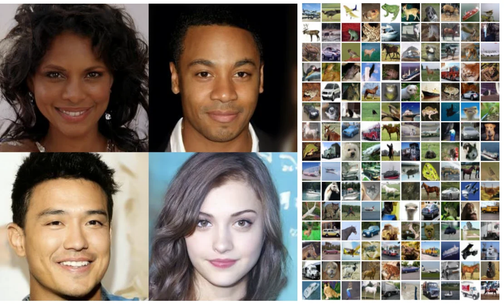
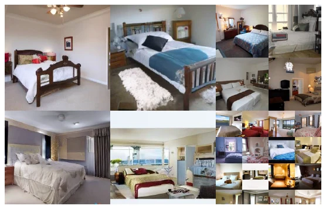
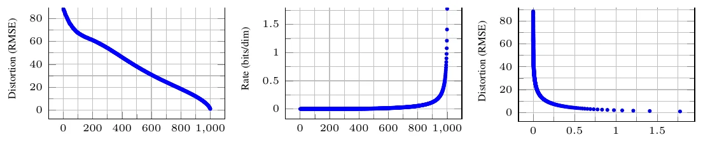
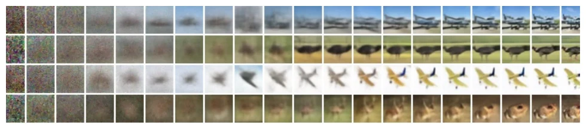
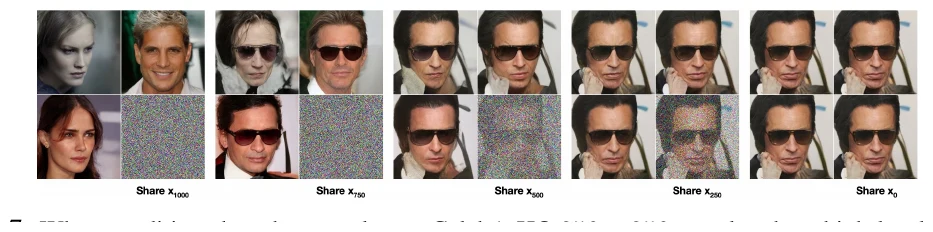
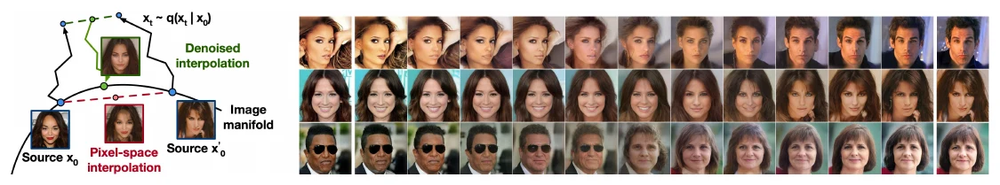

Abstract / 摘要

我们展示了扩散概率模型在高质量图像合成上的结果。这类潜变量模型的灵感来自非平衡热力学。我们最好的结果来自训练一个加权变分下界，其权重由扩散概率模型与去噪分数匹配（denoising score matching）及 Langevin 动力学之间的一个新联系导出。我们的模型还天然支持一种渐进式有损解压方案，可以看作自回归解码的推广。在无条件 CIFAR-10 上，我们取得 Inception score 9.46 与当时最优的 FID 3.17；在 256×256 LSUN 上，样本质量与 ProgressiveGAN 相当。实现代码见 <a href="https://github.com/hojonathanho/diffusion" target="_blank" rel="noopener noreferrer">hojonathanho/diffusion</a>。

扩散概率模型去噪分数匹配Langevin 动力学变分推断图像生成

## 引言 {#introduction}

深度生成模型近来在各种数据模态上都展示出高质量样本。生成对抗网络（GAN）、自回归模型、流模型与变分自编码器（VAE）已经能合成令人印象深刻的图像和音频（Goodfellow 等，2014；van den Oord 等，2016；Dinh 等，2017；Kingma & Welling，2014）；基于能量的建模与分数匹配也取得了显著进展，生成的图像已经可以与 GAN 相提并论（Du & Mordatch，2019；Song & Ermon，2019）。

本文推进**扩散概率模型**（diffusion probabilistic model，下文简称“扩散模型”）。它是一个用变分推断训练的参数化马尔可夫链，在有限步之后产生与数据分布匹配的样本。链的转移被学习去逆转一个扩散过程；后者是一条马尔可夫链，沿着与采样相反的方向逐步向数据加噪，直到信号被破坏。当扩散过程由少量高斯噪声构成时，采样链的转移也可以设为条件高斯，从而允许一种特别简单的神经网络参数化。

扩散模型定义直接、训练高效，但据我们所知，此前还没有工作证明它们能够生成高质量样本。本文表明扩散模型确实可以做到，而且有时优于其他类型生成模型的已发表结果（第 4 节）。此外，扩散模型的某种参数化在训练时与多噪声级别上的去噪分数匹配等价，在采样时与退火 Langevin 动力学等价（第 3.2 节；Song & Ermon，2019；Song 等，2021）。我们用这种参数化取得了最佳的样本质量（第 4.2 节），因此把这一等价性视为本文的主要贡献之一。

尽管样本质量出色，我们的模型在似然上并不如其他基于似然的模型有竞争力；不过，它优于文献中用退火重要性采样为能量模型和分数匹配报告的大估计值（Du & Mordatch，2019；Song & Ermon，2019）。我们发现，模型大部分无损码长都被用来描述不可感知的图像细节（第 4.3 节）。本文用有损压缩的语言对这一现象做了更细致的分析，并说明扩散模型的采样过程是一种**渐进式解码**：它类似自回归解码，但沿着一种被极大推广的位序进行。

## 背景 {#background}

扩散模型（Sohl-Dickstein 等，2015）是形如

$$
p_\theta(\mathbf{x}_0) := \int p_\theta(\mathbf{x}_{0:T})\,d\mathbf{x}_{1:T}
$$

的潜变量模型，其中 $\mathbf{x}_1,\ldots,\mathbf{x}_T$ 是与数据 $\mathbf{x}_0\sim q(\mathbf{x}_0)$ 同维的潜变量。联合分布 $p_\theta(\mathbf{x}_{0:T})$ 称为**逆向过程**（reverse process），它被定义为一条从 $p(\mathbf{x}_T)=\mathcal{N}(\mathbf{x}_T;\mathbf{0},\mathbf{I})$ 出发、带学习高斯转移的马尔可夫链：

$$
p_\theta(\mathbf{x}_{0:T}) := p(\mathbf{x}_T)\prod_{t=1}^{T}p_\theta(\mathbf{x}_{t-1}\mid\mathbf{x}_t),\qquad
p_\theta(\mathbf{x}_{t-1}\mid\mathbf{x}_t):=\mathcal{N}\left(\mathbf{x}_{t-1};\boldsymbol{\mu}_\theta(\mathbf{x}_t,t),\boldsymbol{\Sigma}_\theta(\mathbf{x}_t,t)\right)
\tag{1}
$$

扩散模型与其他潜变量模型的区别在于：近似后验 $q(\mathbf{x}_{1:T}\mid\mathbf{x}_0)$ 被称为**前向过程**或**扩散过程**，它被固定为一条马尔可夫链，按照方差调度 $\beta_1,\ldots,\beta_T$ 逐步向数据加入高斯噪声：

$$
q(\mathbf{x}_{1:T}\mid\mathbf{x}_0):=\prod_{t=1}^{T}q(\mathbf{x}_t\mid\mathbf{x}_{t-1}),\qquad
q(\mathbf{x}_t\mid\mathbf{x}_{t-1}):=\mathcal{N}\left(\mathbf{x}_t;\sqrt{1-\beta_t}\,\mathbf{x}_{t-1},\beta_t\mathbf{I}\right)
\tag{2}
$$

训练通过优化负对数似然的常用变分上界来完成：

$$
\mathbb{E}\left[-\log p_\theta(\mathbf{x}_0)\right]\le \mathbb{E}_q\left[-\log\frac{p_\theta(\mathbf{x}_{0:T})}{q(\mathbf{x}_{1:T}\mid\mathbf{x}_0)}\right]
=\mathbb{E}_q\left[-\log p(\mathbf{x}_T)-\sum_{t\ge1}\log\frac{p_\theta(\mathbf{x}_{t-1}\mid\mathbf{x}_t)}{q(\mathbf{x}_t\mid\mathbf{x}_{t-1})}\right]=:L
\tag{3}
$$

前向过程的方差 $\beta_t$ 可以通过重参数化学习（Kingma & Welling，2014），也可以作为超参数固定；逆向过程的表达能力部分由 $p_\theta(\mathbf{x}_{t-1}\mid\mathbf{x}_t)$ 中选择高斯条件分布来保证，因为当 $\beta_t$ 很小时，前向与逆向两个过程具有相同的函数形式（Sohl-Dickstein 等，2015）。前向过程有一个重要性质：它允许在任意时间步 $t$ 以闭式采样 $\mathbf{x}_t$。记 $\alpha_t:=1-\beta_t$、$\bar\alpha_t:=\prod_{s=1}^{t}\alpha_s$，有

$$
q(\mathbf{x}_t\mid\mathbf{x}_0)=\mathcal{N}\left(\mathbf{x}_t;\sqrt{\bar\alpha_t}\,\mathbf{x}_0,(1-\bar\alpha_t)\mathbf{I}\right)
\tag{4}
$$

因此，我们可以用随机梯度下降优化 $L$ 的随机项，从而高效训练。把 $L$ 重写成 KL 散度之和可以进一步降低方差：

$$
L=\mathbb{E}_q\Big[\underbrace{D_{\mathrm{KL}}\left(q(\mathbf{x}_T\mid\mathbf{x}_0)\,\|\,p(\mathbf{x}_T)\right)}_{L_T}
+\sum_{t>1}\underbrace{D_{\mathrm{KL}}\left(q(\mathbf{x}_{t-1}\mid\mathbf{x}_t,\mathbf{x}_0)\,\|\,p_\theta(\mathbf{x}_{t-1}\mid\mathbf{x}_t)\right)}_{L_{t-1}}
\underbrace{-\log p_\theta(\mathbf{x}_0\mid\mathbf{x}_1)}_{L_0}\Big]
\tag{5}
$$

（推导见附录 A；这些标签会在第 3 节使用。）式 (5) 用 KL 散度直接比较 $p_\theta(\mathbf{x}_{t-1}\mid\mathbf{x}_t)$ 与前向过程的后验；在给定 $\mathbf{x}_0$ 时，这个后验是可解的：

$$
q(\mathbf{x}_{t-1}\mid\mathbf{x}_t,\mathbf{x}_0)=\mathcal{N}\left(\mathbf{x}_{t-1};\tilde{\boldsymbol{\mu}}_t(\mathbf{x}_t,\mathbf{x}_0),\tilde\beta_t\mathbf{I}\right)
\tag{6}
$$

其中

$$
\tilde{\boldsymbol{\mu}}_t(\mathbf{x}_t,\mathbf{x}_0):=\frac{\sqrt{\bar\alpha_{t-1}}\beta_t}{1-\bar\alpha_t}\mathbf{x}_0+\frac{\sqrt{\alpha_t}(1-\bar\alpha_{t-1})}{1-\bar\alpha_t}\mathbf{x}_t,\qquad
\tilde\beta_t:=\frac{1-\bar\alpha_{t-1}}{1-\bar\alpha_t}\beta_t
\tag{7}
$$

于是式 (5) 中所有 KL 散度都是高斯分布之间的比较，可以用闭式表达式做 Rao-Blackwell 化计算，而不必使用高方差的蒙特卡洛估计。

<figure class="article-figure figure--diagram" id="fig-2">

<figcaption>图 2本文考虑的有向图模型：左侧是前向过程 $q(\mathbf{x}_t\mid\mathbf{x}_{t-1})$，右侧是带学习转移的逆向过程 $p_\theta(\mathbf{x}_{t-1}\mid\mathbf{x}_t)$。Ho 等，2020</figcaption>
</figure>

## 扩散模型与去噪自编码器 {#denoising-autoencoders}

扩散模型看起来像一类受限的潜变量模型，但它在实现上其实有很大的自由度：需要选择前向过程的方差 $\beta_t$、模型架构，以及逆向过程的高斯分布参数化。为了给这些选择提供依据，我们建立扩散模型与去噪分数匹配之间的一个显式联系（第 3.2 节），并由此得到一个简化、加权的变分上界目标（第 3.4 节）。最终，模型设计由简洁性与实验结果来检验（第 4 节）。下面的讨论按式 (5) 中的各项展开。

### 3.1 前向过程与 L_T {#forward-process}

我们忽略“前向方差 $\beta_t$ 可以通过重参数化学习”这一事实，改为把它们固定为常数（细节见第 4 节）。因此，在实现中近似后验 $q$ 没有可学习参数，$L_T$ 在训练期间是常数，可以直接忽略。

### 3.2 逆向过程与 L_{1:T-1} {#reverse-process}

现在讨论 $1<t\le T$ 时 $p_\theta(\mathbf{x}_{t-1}\mid\mathbf{x}_t)=\mathcal{N}\left(\mathbf{x}_{t-1};\boldsymbol{\mu}_\theta(\mathbf{x}_t,t),\boldsymbol{\Sigma}_\theta(\mathbf{x}_t,t)\right)$ 的选择。首先，令 $\boldsymbol{\Sigma}_\theta(\mathbf{x}_t,t)=\sigma_t^2\mathbf{I}$，其中 $\sigma_t^2$ 是不参与训练、仅依赖时间的常数。实验上，$\sigma_t^2=\beta_t$ 与 $\sigma_t^2=\tilde\beta_t=\frac{1-\bar\alpha_{t-1}}{1-\bar\alpha_t}\beta_t$ 会得到相似的结果。第一种选择对 $\mathbf{x}_0\sim\mathcal{N}(\mathbf{0},\mathbf{I})$ 最优，第二种选择对 $\mathbf{x}_0$ 确定地取某一点的情形最优；对于坐标方向单位方差的数据，它们分别对应逆向过程熵的上界与下界（Sohl-Dickstein 等，2015）。

其次，为了表示均值 $\boldsymbol{\mu}_\theta(\mathbf{x}_t,t)$，我们提出一种由 $L_t$ 的分析所启发的特定参数化。令 $p_\theta(\mathbf{x}_{t-1}\mid\mathbf{x}_t)=\mathcal{N}\left(\mathbf{x}_{t-1};\boldsymbol{\mu}_\theta(\mathbf{x}_t,t),\sigma_t^2\mathbf{I}\right)$，可以写出

$$
L_{t-1}=\mathbb{E}_q\left[\frac{1}{2\sigma_t^2}\left\|\tilde{\boldsymbol{\mu}}_t(\mathbf{x}_t,\mathbf{x}_0)-\boldsymbol{\mu}_\theta(\mathbf{x}_t,t)\right\|^2\right]+C
\tag{8}
$$

其中 $C$ 是不依赖 $\theta$ 的常数。由此可见，最直接的参数化是让模型预测前向过程的后验均值 $\tilde{\boldsymbol{\mu}}_t$。

不过，我们还可以把式 (8) 进一步展开。利用重参数化

$$
\mathbf{x}_t(\mathbf{x}_0,\boldsymbol{\epsilon})=\sqrt{\bar\alpha_t}\,\mathbf{x}_0+\sqrt{1-\bar\alpha_t}\,\boldsymbol{\epsilon},\qquad \boldsymbol{\epsilon}\sim\mathcal{N}(\mathbf{0},\mathbf{I})
$$

并代入前向过程的后验公式 (7)，得到

$$
\begin{aligned}
L_{t-1}-C=\mathbb{E}_{\mathbf{x}_0,\boldsymbol{\epsilon}}\Bigg[&\frac{1}{2\sigma_t^2}\Bigg\|\tilde{\boldsymbol{\mu}}_t\left(\mathbf{x}_t(\mathbf{x}_0,\boldsymbol{\epsilon}),\frac{1}{\sqrt{\bar\alpha_t}}\left(\mathbf{x}_t(\mathbf{x}_0,\boldsymbol{\epsilon})-\sqrt{1-\bar\alpha_t}\,\boldsymbol{\epsilon}\right)\right)\\
&-\boldsymbol{\mu}_\theta\left(\mathbf{x}_t(\mathbf{x}_0,\boldsymbol{\epsilon}),t\right)\Bigg\|^2\Bigg]
\end{aligned}
\tag{9}
$$

$$
L_{t-1}-C=\mathbb{E}_{\mathbf{x}_0,\boldsymbol{\epsilon}}\left[\frac{1}{2\sigma_t^2}\left\|\frac{1}{\sqrt{\alpha_t}}\left(\mathbf{x}_t(\mathbf{x}_0,\boldsymbol{\epsilon})-\frac{\beta_t}{\sqrt{1-\bar\alpha_t}}\boldsymbol{\epsilon}\right)-\boldsymbol{\mu}_\theta(\mathbf{x}_t(\mathbf{x}_0,\boldsymbol{\epsilon}),t)\right\|^2\right]
\tag{10}
$$

式 (10) 表明：给定 $\mathbf{x}_t$，$\boldsymbol{\mu}_\theta$ 必须预测 $\frac{1}{\sqrt{\alpha_t}}\left(\mathbf{x}_t-\frac{\beta_t}{\sqrt{1-\bar\alpha_t}}\boldsymbol{\epsilon}\right)$。由于 $\mathbf{x}_t$ 是模型的输入，我们可以选择如下参数化：

$$
\boldsymbol{\mu}_\theta(\mathbf{x}_t,t)=\tilde{\boldsymbol{\mu}}_t\left(\mathbf{x}_t,\frac{1}{\sqrt{\bar\alpha_t}}\left(\mathbf{x}_t-\sqrt{1-\bar\alpha_t}\,\boldsymbol{\epsilon}_\theta(\mathbf{x}_t)\right)\right)
=\frac{1}{\sqrt{\alpha_t}}\left(\mathbf{x}_t-\frac{\beta_t}{\sqrt{1-\bar\alpha_t}}\boldsymbol{\epsilon}_\theta(\mathbf{x}_t,t)\right)
\tag{11}
$$

其中 $\boldsymbol{\epsilon}_\theta$ 是一个函数近似器，用来从 $\mathbf{x}_t$ 预测 $\boldsymbol{\epsilon}$。要从 $p_\theta(\mathbf{x}_{t-1}\mid\mathbf{x}_t)$ 采样 $\mathbf{x}_{t-1}$，只需计算

$$
\mathbf{x}_{t-1}=\frac{1}{\sqrt{\alpha_t}}\left(\mathbf{x}_t-\frac{\beta_t}{\sqrt{1-\bar\alpha_t}}\boldsymbol{\epsilon}_\theta(\mathbf{x}_t,t)\right)+\sigma_t\mathbf{z},\qquad \mathbf{z}\sim\mathcal{N}(\mathbf{0},\mathbf{I})
$$

完整的采样过程见算法 2。它以 $\boldsymbol{\epsilon}_\theta$ 作为学习到的数据密度梯度，形式上类似 Langevin 动力学。进一步地，在参数化 (11) 下，式 (10) 简化为

$$
\mathbb{E}_{\mathbf{x}_0,\boldsymbol{\epsilon}}\left[\frac{\beta_t^2}{2\sigma_t^2\alpha_t(1-\bar\alpha_t)}\left\|\boldsymbol{\epsilon}-\boldsymbol{\epsilon}_\theta\left(\sqrt{\bar\alpha_t}\,\mathbf{x}_0+\sqrt{1-\bar\alpha_t}\,\boldsymbol{\epsilon},t\right)\right\|^2\right]
\tag{12}
$$

它类似于在由 $t$ 索引的多个噪声尺度上做去噪分数匹配（Song & Ermon，2019）。由于式 (12) 等于式 (11) 所示 Langevin 式逆向过程变分上界中的一项，我们看到：优化一个类似去噪分数匹配的目标，等价于用变分推断拟合一条类似 Langevin 动力学的采样链的有限时间边缘分布。

总结一下：我们可以训练逆向过程的均值近似器 $\boldsymbol{\mu}_\theta$ 去预测 $\tilde{\boldsymbol{\mu}}_t$；也可以修改它的参数化，让它预测 $\boldsymbol{\epsilon}$。（还可以直接预测 $\mathbf{x}_0$，但在我们的早期实验中，这会明显损害样本质量。）我们已经说明，$\boldsymbol{\epsilon}$-预测参数化既类似 Langevin 动力学，又把扩散模型的变分上界简化成一个类似去噪分数匹配的目标。不过，它终究只是 $p_\theta(\mathbf{x}_{t-1}\mid\mathbf{x}_t)$ 的另一种参数化，因此第 4 节会用消融实验比较预测 $\boldsymbol{\epsilon}$ 与预测 $\tilde{\boldsymbol{\mu}}_t$ 的效果。

Algorithm 2 · 采样Sampling

<ol>
<li>$\mathbf{x}_T\sim\mathcal{N}(\mathbf{0},\mathbf{I})$</li>
<li>for $t=T,\ldots,1$ do</li>
<li>$\mathbf{z}\sim\mathcal{N}(\mathbf{0},\mathbf{I})$，若 $t>1$；否则 $\mathbf{z}=\mathbf{0}$</li>
<li>$\mathbf{x}_{t-1}=\frac{1}{\sqrt{\alpha_t}}\left(\mathbf{x}_t-\frac{\beta_t}{\sqrt{1-\bar\alpha_t}}\boldsymbol{\epsilon}_\theta(\mathbf{x}_t,t)\right)+\sigma_t\mathbf{z}$</li>
<li>end for</li>
<li>return $\mathbf{x}_0$</li>
</ol>

### 3.3 数据缩放与 L_0 {#data-scaling}

我们假设图像数据由 $\{0,1,\ldots,255\}$ 中的整数线性缩放到 $[-1,1]$。这样可以保证神经网络逆向过程始终在统一尺度的输入上运算，并从标准正态先验 $p(\mathbf{x}_T)$ 出发。为了得到离散的对数似然，我们把逆向过程的最后一项设为一个独立的离散解码器，它由高斯分布 $\mathcal{N}\left(\mathbf{x}_0;\boldsymbol{\mu}_\theta(\mathbf{x}_1,1),\sigma_1^2\mathbf{I}\right)$ 导出：

$$
p_\theta(\mathbf{x}_0\mid\mathbf{x}_1)=\prod_{i=1}^{D}\int_{\delta_-(x_0^i)}^{\delta_+(x_0^i)}\mathcal{N}\left(x;\mu_\theta^i(\mathbf{x}_1,1),\sigma_1^2\right)dx
\tag{13}
$$

其中 $D$ 是数据维度，上标 $i$ 表示取出一个坐标，且

$$
\delta_+(x)=\begin{cases}\infty & x=1\\ x+\frac{1}{255} & x<1\end{cases},\qquad
\delta_-(x)=\begin{cases}-\infty & x=-1\\ x-\frac{1}{255} & x>-1\end{cases}
$$

（也可以换成一个更强的解码器，例如条件自回归模型，但我们把它留给未来工作。）与 VAE 解码器和自回归模型中使用的离散化连续分布类似（Kingma & Welling，2014；van den Oord 等，2016），这里的选择保证变分上界是离散数据的无损码长，既不需要向数据中加噪，也不需要把缩放操作的雅可比项纳入对数似然。采样结束时，我们无噪声地输出 $\boldsymbol{\mu}_\theta(\mathbf{x}_1,1)$。

### 3.4 简化的训练目标 {#simplified-objective}

有了上面定义的逆向过程和解码器，由式 (12) 与式 (13) 导出的变分上界显然对 $\theta$ 可微，可以直接用于训练。不过，我们发现训练变分上界的下面这个变体对样本质量更有利，实现也更简单：

$$
L_{\mathrm{simple}}(\theta):=\mathbb{E}_{t,\mathbf{x}_0,\boldsymbol{\epsilon}}\left[\left\|\boldsymbol{\epsilon}-\boldsymbol{\epsilon}_\theta\left(\sqrt{\bar\alpha_t}\,\mathbf{x}_0+\sqrt{1-\bar\alpha_t}\,\boldsymbol{\epsilon},t\right)\right\|^2\right]
\tag{14}
$$

其中 $t$ 在 $1$ 到 $T$ 之间均匀采样。$t=1$ 对应 $L_0$：把离散解码器定义 (13) 中的积分近似为高斯概率密度乘以分箱宽度，并忽略 $\sigma_1^2$ 与边界效应。$t>1$ 对应式 (12) 的无权重版本，类似 NCSN 去噪分数匹配模型使用的损失加权（Song & Ermon，2019）。（因为前向过程方差 $\beta_t$ 固定，$L_T$ 不会出现。）算法 1 给出了使用这个简化目标的完整训练过程。

由于简化目标 (14) 丢掉了式 (12) 中的权重，它实际上是一个**加权**变分上界，会相对标准变分上界（Kingma & Welling，2014；Rezende 等，2014）强调重构的不同方面。特别地，第 4 节的扩散过程设置会让简化目标降低小 $t$ 损失项的权重。这些项训练网络去除非常少量的噪声，把它们降权可以让网络把精力集中到更大 $t$ 上更困难的任务。实验将表明，这种重新加权带来了更好的样本质量。

Algorithm 1 · 训练Training

<ol>
<li>repeat</li>
<li>$\mathbf{x}_0\sim q(\mathbf{x}_0)$</li>
<li>$t\sim\mathrm{Uniform}(\{1,\ldots,T\})$</li>
<li>$\boldsymbol{\epsilon}\sim\mathcal{N}(\mathbf{0},\mathbf{I})$</li>
<li>对目标做一步梯度下降：</li>
<li>$\nabla_\theta\left\|\boldsymbol{\epsilon}-\boldsymbol{\epsilon}_\theta\left(\sqrt{\bar\alpha_t}\,\mathbf{x}_0+\sqrt{1-\bar\alpha_t}\,\boldsymbol{\epsilon},t\right)\right\|^2$</li>
<li>until 收敛</li>
</ol>

## 实验 {#experiments}

我们对所有实验都设 $T=1000$，使采样时所需的神经网络评估次数与先前工作相当（Sohl-Dickstein 等，2015；Song & Ermon，2019）。前向过程的方差固定为从 $\beta_1=10^{-4}$ 到 $\beta_T=0.02$ 线性递增的常数。这些常数相对于缩放到 $[-1,1]$ 的数据足够小，既保证逆向过程与前向过程具有近似相同的函数形式，又让 $\mathbf{x}_T$ 处的信噪比尽可能小（在我们的实验中，$L_T=D_{\mathrm{KL}}\left(q(\mathbf{x}_T\mid\mathbf{x}_0)\,\|\,\mathcal{N}(\mathbf{0},\mathbf{I})\right)\approx10^{-5}$ bits/dim）。

逆向过程使用一个 U-Net 骨干，结构类似未掩码的 PixelCNN++（Salimans 等，2017；van den Oord 等，2016），全程使用组归一化（Wu & He，2018）。参数在时间上共享，时间 $t$ 通过 Transformer 正弦位置嵌入（Vaswani 等，2017）输入网络。我们在 $16\times16$ 的特征图分辨率上使用自注意力（Parmar 等，2018；Vaswani 等，2017）。细节见附录 B。

### 4.1 样本质量 {#sample-quality}

表 1 给出了 CIFAR-10 上的 Inception score、FID 与负对数似然（无损码长）。我们的无条件模型取得 FID 3.17，样本质量优于文献中的大多数模型，包括一些类条件模型。FID 按惯例相对训练集计算；若相对测试集计算，分数为 5.24，仍优于文献中许多训练集 FID。

<table class="paper-table">
<caption>表 1CIFAR-10 结果。NLL 以 bits/dim 计，括号内为训练集数值。</caption>
<thead><tr><th>模型</th><th>IS</th><th>FID</th><th>NLL 测试（训练）</th></tr></thead>
<tbody>
<tr class="row-group"><th colspan="4">条件模型</th></tr>
<tr><td>EBM</td><td>8.30</td><td>37.9</td><td>—</td></tr>
<tr><td>JEM</td><td>8.76</td><td>38.4</td><td>—</td></tr>
<tr><td>BigGAN</td><td>9.22</td><td>14.73</td><td>—</td></tr>
<tr><td>StyleGAN2 + ADA (v1)</td><td>10.06</td><td>2.67</td><td>—</td></tr>
<tr class="row-group"><th colspan="4">无条件模型</th></tr>
<tr><td>Diffusion (original)</td><td>—</td><td>—</td><td>≤ 5.40</td></tr>
<tr><td>Gated PixelCNN</td><td>4.60</td><td>65.93</td><td>3.03（2.90）</td></tr>
<tr><td>Sparse Transformer</td><td>—</td><td>—</td><td>2.80</td></tr>
<tr><td>PixelIQN</td><td>5.29</td><td>49.46</td><td>—</td></tr>
<tr><td>EBM</td><td>6.78</td><td>38.2</td><td>—</td></tr>
<tr><td>NCSNv2</td><td>—</td><td>31.75</td><td>—</td></tr>
<tr><td>NCSN</td><td>8.87±0.12</td><td>25.32</td><td>—</td></tr>
<tr><td>SNGAN</td><td>8.22±0.05</td><td>21.7</td><td>—</td></tr>
<tr><td>SNGAN-DDLS</td><td>9.09±0.10</td><td>15.42</td><td>—</td></tr>
<tr><td>StyleGAN2 + ADA (v1)</td><td>9.74±0.05</td><td>3.26</td><td>—</td></tr>
<tr class="is-ours"><td>Ours（$L$，固定各向同性 $\boldsymbol{\Sigma}$）</td><td>7.67±0.13</td><td>13.51</td><td>≤ 3.70（3.69）</td></tr>
<tr class="is-ours"><td>Ours（$L_{\mathrm{simple}}$）</td><td>9.46±0.11</td><td>3.17</td><td>≤ 3.75（3.72）</td></tr>
</tbody>
</table>

<figure class="article-figure figure--wide" id="fig-1">

<figcaption>图 1CelebA-HQ 256×256（左）与无条件 CIFAR-10（右）的生成样本。Ho 等，2020</figcaption>
</figure>

<figure class="article-figure figure--small" id="fig-3">

<figcaption>图 3LSUN Church 样本，FID=7.89。Ho 等，2020</figcaption>
</figure>
<figure class="article-figure figure--small" id="fig-4">

<figcaption>图 4LSUN Bedroom 样本，FID=4.90。Ho 等，2020</figcaption>
</figure>

我们发现，用真实变分上界训练的模型确实比用简化目标训练的模型有更好的码长（符合预期），但后者带来最好的样本质量。CIFAR-10 与 CelebA-HQ 256×256 的样本见图 1，LSUN 256×256 的样本见图 3 与图 4（Yu 等，2015），更多样本见附录 D。

### 4.2 参数化与训练目标消融 {#ablation}

表 2 展示了逆向过程参数化与训练目标对样本质量的影响（第 3.2 节）。我们发现，“预测 $\tilde{\boldsymbol{\mu}}$”这一基线只有在真实变分上界（而不是式 (14) 那种无权重均方误差）下训练时才表现良好。把参数化的对角 $\boldsymbol{\Sigma}_\theta(\mathbf{x}_t)$ 纳入变分上界来学习逆向方差，会导致训练不稳定、样本质量变差；相比之下，固定方差更可靠。我们提出的 $\boldsymbol{\epsilon}$-预测，在固定方差、真实变分上界下与预测 $\tilde{\boldsymbol{\mu}}$ 表现相近，但在简化目标下明显更好。

<table class="paper-table">
<caption>表 2无条件 CIFAR-10 上逆向过程参数化与训练目标的消融。空白表示训练不稳定或样本分数超出量程。</caption>
<thead><tr><th>目标</th><th>IS</th><th>FID</th></tr></thead>
<tbody>
<tr class="row-group"><th colspan="3">$\tilde{\boldsymbol{\mu}}$ 预测（基线）</th></tr>
<tr><td>$L$，学习对角 $\boldsymbol{\Sigma}$</td><td>7.28±0.10</td><td>23.69</td></tr>
<tr><td>$L$，固定各向同性 $\boldsymbol{\Sigma}$</td><td>8.06±0.09</td><td>13.22</td></tr>
<tr><td>$\|\tilde{\boldsymbol{\mu}}-\tilde{\boldsymbol{\mu}}_\theta\|^2$</td><td>—</td><td>—</td></tr>
<tr class="row-group"><th colspan="3">$\boldsymbol{\epsilon}$ 预测（本文）</th></tr>
<tr><td>$L$，学习对角 $\boldsymbol{\Sigma}$</td><td>—</td><td>—</td></tr>
<tr><td>$L$，固定各向同性 $\boldsymbol{\Sigma}$</td><td>7.67±0.13</td><td>13.51</td></tr>
<tr class="is-ours"><td>$\|\boldsymbol{\epsilon}-\boldsymbol{\epsilon}_\theta\|^2$（$L_{\mathrm{simple}}$）</td><td>9.46±0.11</td><td>3.17</td></tr>
</tbody>
</table>

### 4.3 渐进式编码 {#progressive-coding}

表 1 还给出了 CIFAR-10 模型的码长。训练集与测试集之间的差距最多为 0.03 bits/dim，与其他基于似然的模型报告的差距相当，说明扩散模型没有过拟合（最近邻可视化见附录 D）。不过，虽然我们的无损码长优于能量模型与分数匹配用退火重要性采样报告的大估计值（Du & Mordatch，2019），但仍无法与其他类型的基于似然的生成模型相比（Child 等，2019）。

既然样本质量很高，我们推断扩散模型具有一种归纳偏置，使它成为出色的**有损压缩器**。把变分上界中的 $L_1+\cdots+L_T$ 视为码率、$L_0$ 视为失真，样本质量最高的 CIFAR-10 模型码率为 1.78 bits/dim、失真为 1.97 bits/dim；换算到 0 到 255 的尺度，均方根误差为 0.95。超过一半的无损码长都在描述不可感知的失真。

**渐进式有损压缩**　我们可以引入一种渐进式有损编码，进一步探测模型的率失真行为。它的形式对应式 (5)：见算法 3 与算法 4。它们假设存在一种过程（例如 minimal random coding，Harsha 等，2007；Havasi 等，2019），能在平均约 $D_{\mathrm{KL}}(q(\mathbf{x})\,\|\,p(\mathbf{x}))$ 比特内传输样本 $\mathbf{x}\sim q(\mathbf{x})$，其中接收方事先只知道 $p$。把该过程用于 $\mathbf{x}_0\sim q(\mathbf{x}_0)$，算法 3 与算法 4 会依次传输 $\mathbf{x}_T,\ldots,\mathbf{x}_0$，总期望码长等于式 (5)。接收方在任意时刻 $t$ 都完整地拥有部分信息 $\mathbf{x}_t$，可以渐进地估计

$$
\mathbf{x}_0\approx\hat{\mathbf{x}}_0=\left(\mathbf{x}_t-\sqrt{1-\bar\alpha_t}\,\boldsymbol{\epsilon}_\theta(\mathbf{x}_t)\right)/\sqrt{\bar\alpha_t}
\tag{15}
$$

这是由式 (4) 得到的。（随机重构 $\mathbf{x}_0\sim p_\theta(\mathbf{x}_0\mid\mathbf{x}_t)$ 也成立，但这里不采用，因为它让失真更难评估。）图 5 给出了 CIFAR-10 测试集上的率失真曲线。在每个时刻 $t$，失真按均方根误差 $\|\mathbf{x}_0-\hat{\mathbf{x}}_0\|_2/\sqrt{D}$ 计算，码率按截至 $t$ 已接收的累积比特数计算。失真在低码率区域急剧下降，说明大部分比特确实被分配给了不可感知的失真。

Algorithm 3 · 发送 $\mathbf{x}_0$Sending

<ol>
<li>发送 $\mathbf{x}_T\sim q(\mathbf{x}_T\mid\mathbf{x}_0)$，使用 $p(\mathbf{x}_T)$</li>
<li>for $t=T-1,\ldots,2,1$ do</li>
<li>发送 $\mathbf{x}_t\sim q(\mathbf{x}_t\mid\mathbf{x}_{t+1},\mathbf{x}_0)$，使用 $p_\theta(\mathbf{x}_t\mid\mathbf{x}_{t+1})$</li>
<li>end for</li>
<li>发送 $\mathbf{x}_0$，使用 $p_\theta(\mathbf{x}_0\mid\mathbf{x}_1)$</li>
</ol>

Algorithm 4 · 接收Receiving

<ol>
<li>使用 $p(\mathbf{x}_T)$ 接收 $\mathbf{x}_T$</li>
<li>for $t=T-1,\ldots,1,0$ do</li>
<li>使用 $p_\theta(\mathbf{x}_t\mid\mathbf{x}_{t+1})$ 接收 $\mathbf{x}_t$</li>
<li>end for</li>
<li>return $\mathbf{x}_0$</li>
</ol>

<figure class="article-figure figure--wide" id="fig-5">

<figcaption>图 5无条件 CIFAR-10 测试集上的率失真与时间关系。失真按 0–255 尺度上的均方根误差度量，细节见原文表 4。Ho 等，2020</figcaption>
</figure>

### 渐进生成 {#progressive-generation}

我们还运行了一个渐进式无条件生成过程，即从随机比特进行渐进式解压。换句话说，在按算法 2 从逆向过程采样时，我们同时预测逆向过程的结果 $\hat{\mathbf{x}}_0$。图 6 与附录图 10 展示了 $\hat{\mathbf{x}}_0$ 在逆向过程中的样本质量变化：大尺度图像特征先出现，细节最后出现。图 7 展示了固定 $\mathbf{x}_t$ 时从 $p_\theta(\mathbf{x}_0\mid\mathbf{x}_t)$ 采样的随机预测：$t$ 较小时，除了细微细节外都被保留；$t$ 较大时，只保留大尺度特征。这或许可以看作“概念压缩”的迹象（Gregor 等，2016）。

<figure class="article-figure figure--wide" id="fig-6">

<figcaption>图 6无条件 CIFAR-10 渐进生成（$\hat{\mathbf{x}}_0$ 随时间变化，从左到右）。更多样本与指标见附录图 10、图 14。Ho 等，2020</figcaption>
</figure>

<figure class="article-figure figure--wide" id="fig-7">

<figcaption>图 7在相同潜在变量条件下，CelebA-HQ 256×256 样本共享高层属性。每组右下角是 $\mathbf{x}_t$，其余是从 $p_\theta(\mathbf{x}_0\mid\mathbf{x}_t)$ 采样的结果。Ho 等，2020</figcaption>
</figure>

### 与自回归解码的联系 {#autoregressive-connection}

注意，变分上界 (5) 还可以重写为

$$
L=D_{\mathrm{KL}}\left(q(\mathbf{x}_T)\,\|\,p(\mathbf{x}_T)\right)+\mathbb{E}_q\left[\sum_{t\ge1}D_{\mathrm{KL}}\left(q(\mathbf{x}_{t-1}\mid\mathbf{x}_t)\,\|\,p_\theta(\mathbf{x}_{t-1}\mid\mathbf{x}_t)\right)\right]+H(\mathbf{x}_0)
\tag{16}
$$

（推导见附录 A。）现在考虑把扩散过程长度 $T$ 设为数据维度，并定义前向过程使 $q(\mathbf{x}_t\mid\mathbf{x}_0)$ 把所有概率质量放在“前 $t$ 个坐标被掩掉”的 $\mathbf{x}_0$ 上（即 $q(\mathbf{x}_t\mid\mathbf{x}_{t-1})$ 掩掉第 $t$ 个坐标）；令 $p(\mathbf{x}_T)$ 把所有质量放在一张空白图像上；并为了论证方便，令 $p_\theta(\mathbf{x}_{t-1}\mid\mathbf{x}_t)$ 为完全表达的条件分布。在这些选择下，$D_{\mathrm{KL}}\left(q(\mathbf{x}_T)\,\|\,p(\mathbf{x}_T)\right)=0$，而最小化 $D_{\mathrm{KL}}\left(q(\mathbf{x}_{t-1}\mid\mathbf{x}_t)\,\|\,p_\theta(\mathbf{x}_{t-1}\mid\mathbf{x}_t)\right)$ 会训练 $p_\theta$ 原样复制坐标 $t+1,\ldots,T$，并在给定 $t+1,\ldots,T$ 时预测第 $t$ 个坐标。因此，用这种特殊扩散训练 $p_\theta$，就是在训练一个自回归模型。

于是，我们可以把高斯扩散模型 (2) 理解为一种自回归模型，它使用一种无法通过重排数据坐标得到的广义位序。已有工作表明，这类重排会引入影响样本质量的归纳偏置（Ho 等，2019），因此我们推测高斯扩散起到类似作用，而且效果可能更强，因为对图像而言，加高斯噪声或许比加掩码噪声更自然。此外，高斯扩散的长度不必等于数据维度；例如我们在实验中使用 $T=1000$，小于 $32\times32\times3$ 或 $256\times256\times3$ 图像的维度。高斯扩散可以缩短以加快采样，也可以加长以增强模型表达能力。

### 4.4 插值 {#interpolation}

我们可以把源图像 $\mathbf{x}_0,\mathbf{x}_0'\sim q(\mathbf{x}_0)$ 在潜空间中做插值：用 $q$ 作为随机编码器得到 $\mathbf{x}_t,\mathbf{x}_t'\sim q(\mathbf{x}_t\mid\mathbf{x}_0)$，再把线性插值后的潜变量 $\bar{\mathbf{x}}_t=(1-\lambda)\mathbf{x}_t+\lambda\mathbf{x}_t'$ 通过逆向过程解码回图像空间，$\bar{\mathbf{x}}_0\sim p(\mathbf{x}_0\mid\bar{\mathbf{x}}_t)$。实际效果是：用逆向过程去除“对源图像加噪版本做线性插值”所产生的伪影，如图 8（左）所示。我们对不同的 $\lambda$ 固定噪声，使 $\mathbf{x}_t$ 与 $\mathbf{x}_t'$ 保持不变。图 8（右）展示了原始 CelebA-HQ 256×256 图像（$t=500$）的插值与重构。逆向过程能给出高质量的重构，以及平滑改变姿态、肤色、发型、表情和背景（但不包括眼镜）的合理插值。更大的 $t$ 会产生更粗糙、更多样的插值；在 $t=1000$ 时会出现全新的样本（附录图 9）。

<figure class="article-figure figure--wide" id="fig-8">

<figcaption>图 8CelebA-HQ 256×256 图像的插值，使用 500 步扩散。Ho 等，2020</figcaption>
</figure>

## 相关工作 {#related-work}

扩散模型可能与流模型（Dinh 等，2017；Papamakarios 等，2019；Ho 等，2019；Chen 等，2018；Grathwohl 等，2019；Huang 等，2018）和 VAE（Kingma & Welling，2014；Rezende 等，2014；van den Oord 等，2017）相似，但扩散模型的设计使 $q$ 没有参数，且顶层潜变量 $\mathbf{x}_T$ 与数据 $\mathbf{x}_0$ 的互信息几乎为零。我们的 $\boldsymbol{\epsilon}$-预测逆向过程参数化，在扩散模型与多噪声级别去噪分数匹配、退火 Langevin 采样之间建立了联系（Song & Ermon，2019，2020）。不过，扩散模型可以直接计算对数似然，并且训练过程显式地通过变分推断来训练 Langevin 动力学采样器（细节见附录 C）。这一联系还有反向含义：某种加权形式的去噪分数匹配，等价于用变分推断训练一个类似 Langevin 的采样器。学习马尔可夫链转移算子的其他方法包括 infusion training（Bordes 等，2017）、variational walkback（Goyal 等，2017）、生成随机网络（Alain 等，2016）等（Bengio 等，2014；Salimans 等，2015；Kim 等，2016；Song，2017；Levy 等，2018；Nijkamp 等，2019）。

由分数匹配与基于能量的建模之间的已知联系，我们的工作也可能影响近期关于能量模型的研究（Xie 等，2016；Xie 等，2018；Du & Mordatch，2019；Nijkamp 等，2019；Grathwohl 等，2020；Du 等，2020；Du & Mordatch，2020；Nijkamp 等，2020；Du 等，2021）。我们的率失真曲线是在一次变分上界评估中沿时间计算的，这让人联想到退火重要性采样可以在一次运行中沿失真惩罚计算率失真曲线（Neal，2001）。我们的渐进式解码论证可以在卷积 DRAW 及相关模型中看到（Gregor 等，2016；Khemakhem 等，2019），也可能为自回归模型的子尺度排序或采样策略带来更一般的设计（Ho 等，2019；Menick & Kalchbrenner，2018）。

## 结论 {#conclusion}

我们展示了扩散模型的高质量图像样本，并发现了扩散模型与以下对象之间的联系：用于训练马尔可夫链的变分推断、去噪分数匹配与退火 Langevin 动力学（以及由此延伸的能量模型）、自回归模型，以及渐进式有损压缩。由于扩散模型似乎对图像数据具有出色的归纳偏置，我们期待研究它在其他数据模态中的用途，以及它作为其他生成模型和机器学习系统组件的潜力。

## 更广泛的影响 {#broader-impact}

我们关于扩散模型的工作，与现有其他类型深度生成模型的研究范围相似，例如提升 GAN、流模型、自回归模型等的样本质量。本文让扩散模型成为这类技术中一个更有用的工具，因此它可能会放大生成模型已经（以及将会）对更广大世界产生的影响。

遗憾的是，生成模型有许多众所周知的恶意用途。样本生成技术可以被用来制造公众人物的虚假图像和视频，以达到政治目的。虽然在软件工具出现之前，假图像早已被手工制造，但像我们这样的生成模型让这个过程变得更容易。幸运的是，CNN 生成的图像目前还有一些可以被检测出来的细微瑕疵（Wang 等，2020），但生成模型的进步可能让检测变得越来越困难。生成模型还会反映训练数据中的偏见。许多大型数据集是由自动化系统从互联网上收集的，其中的偏见很难被清除，尤其是在图像没有标注的情况下。如果在这些数据集上训练的生成模型样本在互联网上大量传播，这些偏见只会被进一步强化。

另一方面，扩散模型可能有助于数据压缩。随着数据分辨率提高、全球互联网流量增长，压缩对于保证互联网对广泛人群的可及性可能至关重要。我们的工作也可能有助于在无标注原始数据上做表征学习，服务于从图像分类到强化学习的大量下游任务；扩散模型也可能在艺术、摄影和音乐等创意用途上变得可行。

## 附录导读 {#appendix}

<strong>说明：</strong>正文为全译；附录体量较大，这里给出各附录的结构、关键结论与实验细节，公式编号对应原文。完整的逐步推导与样本网格请参阅 <a href="https://arxiv.org/pdf/2006.11239" target="_blank" rel="noopener noreferrer">PDF 原文</a>。

### A. 扩展推导 {#appendix-a}

附录 A 给出了式 (5) 的完整推导，材料来自 Sohl-Dickstein 等（2015）。核心步骤是把联合分布与近似后验的比值拆成三部分：

$$
L=\mathbb{E}_q\left[-\log\frac{p_\theta(\mathbf{x}_{0:T})}{q(\mathbf{x}_{1:T}\mid\mathbf{x}_0)}\right]
=\mathbb{E}_q\left[-\log p(\mathbf{x}_T)-\sum_{t\ge1}\log\frac{p_\theta(\mathbf{x}_{t-1}\mid\mathbf{x}_t)}{q(\mathbf{x}_t\mid\mathbf{x}_{t-1})}\right]
\tag{17}
$$

利用 $q(\mathbf{x}_t\mid\mathbf{x}_{t-1})=q(\mathbf{x}_{t-1}\mid\mathbf{x}_t,\mathbf{x}_0)q(\mathbf{x}_t\mid\mathbf{x}_0)/q(\mathbf{x}_{t-1}\mid\mathbf{x}_0)$（贝叶斯公式），并把 $t>1$ 与 $t=1$ 分开，可以得到

$$
L=\mathbb{E}_q\left[D_{\mathrm{KL}}\left(q(\mathbf{x}_T\mid\mathbf{x}_0)\,\|\,p(\mathbf{x}_T)\right)
+\sum_{t>1}D_{\mathrm{KL}}\left(q(\mathbf{x}_{t-1}\mid\mathbf{x}_t,\mathbf{x}_0)\,\|\,p_\theta(\mathbf{x}_{t-1}\mid\mathbf{x}_t)\right)
-\log p_\theta(\mathbf{x}_0\mid\mathbf{x}_1)\right]
\tag{22}
$$

这正是式 (5)。附录还给出了另一种不可直接估计、但对第 4.3 节讨论有用的形式：

$$
L=D_{\mathrm{KL}}\left(q(\mathbf{x}_T)\,\|\,p(\mathbf{x}_T)\right)
+\mathbb{E}_q\left[\sum_{t\ge1}D_{\mathrm{KL}}\left(q(\mathbf{x}_{t-1}\mid\mathbf{x}_t)\,\|\,p_\theta(\mathbf{x}_{t-1}\mid\mathbf{x}_t)\right)\right]
+H(\mathbf{x}_0)
\tag{26}
$$

式 (26) 把扩散模型的训练目标写成了“先验匹配 + 逐级去噪 + 数据熵”，这也是把它解释为渐进式解码的起点。

### B. 实验细节 {#appendix-b}

网络骨干沿用 PixelCNN++（Salimans 等，2017），即基于 Wide ResNet（Zagoruyko & Komodakis，2016）的 U-Net（Ronneberger 等，2015）。作者把权重归一化换成组归一化（Wu & He，2018）以简化实现。32×32 模型使用四个特征图分辨率（32×32 到 4×4），256×256 模型使用六个；每个分辨率两级卷积残差块，并在 16×16 分辨率、卷积块之间插入自注意力（Chen 等，2018）。扩散时间 $t$ 通过在每个残差块中加入 Transformer 正弦位置嵌入（Vaswani 等，2017）来指定。

模型规模：CIFAR-10 模型 3570 万参数；LSUN 与 CelebA-HQ 模型 1.14 亿参数；还训练了一个约 2.56 亿参数的更大 LSUN Bedroom 变体。所有实验使用 TPU v3-8（约等于 8 块 V100）。CIFAR 模型在 batch size 128 下每秒 21 步，训练到 80 万步约 10.6 小时；采样 256 张图约 17 秒。CelebA-HQ/LSUN 模型在 batch size 64 下每秒 2.2 步，采样 128 张图约 300 秒。训练步数：CelebA-HQ 50 万、LSUN Bedroom 240 万、LSUN Cat 180 万、LSUN Church 120 万；更大的 Bedroom 模型训练 115 万步。

主要超参数：$\beta_t$ 在常数、线性、二次调度中选择，均约束 $L_T\approx0$；最终取 $T=1000$、从 $10^{-4}$ 线性增加到 $0.02$。CIFAR-10 的 dropout 在 $\{0.1,0.2,0.3,0.4\}$ 中选为 0.1，其他数据集为 0；CIFAR-10 与除 LSUN Bedroom 外的数据集使用随机水平翻转；优化器选 Adam（Kingma & Ba，2015），学习率 $2\times10^{-4}$，256×256 图像降为 $2\times10^{-5}$；batch size 分别为 128 与 64；参数 EMA 衰减 0.9999。样本质量与对数似然报告训练过程中最优的 FID。

### C. 与相关工作的讨论 {#appendix-c}

附录 C 详细比较了本文与 NCSN（Song & Ermon，2019，2020）。两者在架构、前向过程定义和先验上都有细微但重要的差别：本文使用带自注意力的 U-Net，NCSN 使用带空洞卷积的 RefineNet；本文通过正弦位置嵌入在所有层上对 $t$ 做条件，而不只是在归一化层或输出端；扩散模型在每一步按 $\sqrt{1-\beta_t}$ 缩小数据，使加噪时方差不会增长，从而保持输入尺度一致；最重要的是，本文把采样器直接作为潜变量模型训练，而不是在训练后事后加一个采样器。

### D. 样本 {#appendix-d}

附录 D 给出了更多 CelebA-HQ、CIFAR-10 与 LSUN 的样本网格，以及最近邻可视化。为避免页面体积过大，本页不重复收录这些大图；可对照 PDF 原文第 18–25 页查看。

## 延伸阅读 {#further-reading}

- **Sohl-Dickstein 等，2015**：[Deep Unsupervised Learning using Nonequilibrium Thermodynamics](https://arxiv.org/abs/1503.03585)。扩散模型的思想源头，本文第 2 节的推导主要来自这里。
- **Song & Ermon，2019**：[Generative Modeling by Estimating Gradients of the Data Distribution](https://arxiv.org/abs/1907.05600)。NCSN 与去噪分数匹配，是理解 $\boldsymbol{\epsilon}$-预测的关键对照。
- **Song 等，2021**：[Score-Based Generative Modeling through Stochastic Differential Equations](https://arxiv.org/abs/2011.13456)。把扩散模型写成 SDE，统一了采样与分数匹配的视角。
- **Nichol & Dhariwal，2021**：[Improved Denoising Diffusion Probabilistic Models](https://arxiv.org/abs/2102.09672)。学习方差、余弦调度与更合理的似然评估。
- **Song 等，2021**：[Denoising Diffusion Implicit Models](https://arxiv.org/abs/2010.02502)。用非马尔可夫前向过程把采样步数大幅压缩。
- **Dhariwal & Nichol，2021**：[Diffusion Models Beat GANs on Image Synthesis](https://arxiv.org/abs/2105.05233)。分类器引导与架构消融，扩散模型开始全面超越 GAN。
- **Rombach 等，2022**：[High-Resolution Image Synthesis with Latent Diffusion Models](https://arxiv.org/abs/2112.10752)。把扩散搬到潜空间，Stable Diffusion 的直接前身。
- **Ho & Salimans，2022**：[Classifier-Free Diffusion Guidance](https://arxiv.org/abs/2207.12598)。无分类器引导，现代文生图模型的常用组件。
- **Karras 等，2022**：[Elucidating the Design Space of Diffusion-Based Generative Models](https://arxiv.org/abs/2206.00364)。从 ODE/SDE 角度重新整理扩散模型的设计空间。
- **Salimans & Ho，2022**：[Progressive Distillation for Fast Sampling of Diffusion Models](https://arxiv.org/abs/2202.00512)。把多步采样蒸馏成少步采样。
