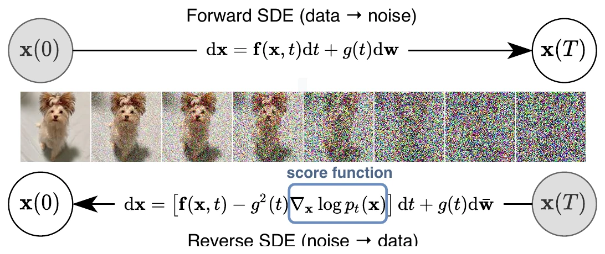
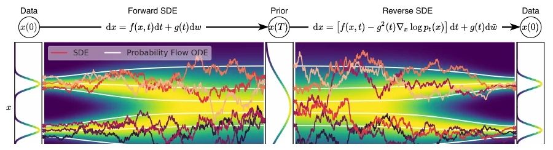
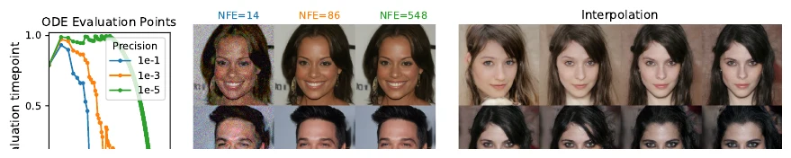
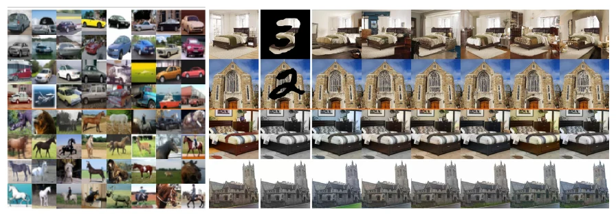

Abstract / 摘要

从数据制造噪声很容易；从噪声制造数据，就是生成建模。本文提出一条随机微分方程（SDE），通过缓慢注入噪声，把复杂的数据分布平滑地变换成已知先验；并给出对应的逆向时间 SDE，通过缓慢去噪把先验变回数据。关键在于：逆向 SDE 只依赖扰动数据分布随时间的梯度场，也就是 <strong>score</strong>。借助 score-based 生成模型的进展，我们可以用神经网络估计这些 score，再用数值 SDE 求解器采样。该框架统一了此前的 score-based 模型与扩散概率模型，带来新的采样方法和建模能力。我们提出 predictor-corrector 框架来修正离散化误差；推导出与 SDE 同分布的 neural ODE，从而支持精确似然计算和更高效的采样；并给出用 score 模型求解逆问题的新方法，在类条件生成、图像修复与上色上展示效果。结合架构改进，我们在 CIFAR-10 无条件生成上取得 Inception score 9.89、FID 2.20，似然 2.99 bits/dim，并首次用 score-based 模型生成 1024×1024 的 CelebA-HQ 图像。

<strong>读法：</strong>论文标题是 generative modeling，但它的核心产物不是一个图像生成器，而是一个随时间和条件变化的 score 场。生成只是其中一个任务；本文真正打开的是 <strong>score-based diffusion</strong> 作为通用推断框架的空间。

score matchingSDE概率流 ODEpredictor-corrector逆问题

## 引言：从离散噪声尺度到连续 SDE {#introduction}

有两类成功的生成模型，思路都是“先逐步破坏训练数据，再学习逆转这个破坏过程”：

- **SMLD**（Score Matching with Langevin Dynamics，Song & Ermon，2019）：在多个噪声尺度上估计 score，也就是数据对数密度对数据的梯度，然后用 Langevin 动力学从大到小逐级采样；
- **DDPM**（Denoising Diffusion Probabilistic Models，Sohl-Dickstein 等，2015；Ho 等，2020）：训练一串概率模型去逆转每一步加噪，利用逆向分布的函数形式让训练可解。

在连续状态空间里，DDPM 的训练目标其实隐式地计算了每个噪声尺度上的 score。因此本文把这两类模型统称为 **score-based 生成模型**。更准确地说，本文关心的是 **score-based diffusion**：score 场是模型，生成只是它的一种用法。

它们已经在图像、音频、图和形状生成上被证明有效。但此前的做法都基于**有限个离散噪声尺度**。本文提出一个统一框架：不再使用有限个噪声分布，而是考虑一族随时间连续演化的分布——由一条**不依赖数据、没有可训练参数**的 SDE 描述。

具体来说，前向 SDE 把数据点逐渐扩散成随机噪声；逆向这个 SDE，就能把噪声“塑形”回数据。Anderson（1982）的经典结果告诉我们：逆向过程也是一条扩散过程，它的漂移项只需要前向 SDE 的系数和**每个时刻边缘分布的 score**。于是我们可以：

1. 用一个时间相关的神经网络 $s_\theta(\mathbf{x},t)$ 估计 $\nabla_{\mathbf{x}}\log p_t(\mathbf{x})$；
2. 用任意通用 SDE 求解器数值积分逆向 SDE，得到样本；
3. 或者积分对应的概率流 ODE，得到确定性采样、精确似然和可逆编码。

<figure class="article-figure figure--wide" id="fig-forward-reverse">

<figcaption>图 1求解逆向时间 SDE 就得到 score-based 生成模型：前向 SDE 把数据变成简单噪声分布；只要知道每个中间时刻的 score，就能反转它。Song 等，2021，图 1</figcaption>
</figure>

本文的主要贡献可以概括为四点：

- **灵活的采样与似然计算**：任意通用 SDE 求解器都可以用来采样；此外还有两类特殊方法——(i) 把数值 SDE 求解器与 score-based MCMC（如 Langevin、HMC）结合的 predictor-corrector 采样器；(ii) 基于概率流 ODE 的确定性采样器。后者带来快速自适应采样、潜码操作、唯一可识别编码，以及精确似然。
- **可控生成**：给定不完整信息或类别标签，可以构造条件逆向 SDE，而不需要重新训练一个条件模型。同一套无条件 score 模型即可做类条件生成、图像修复、上色等逆问题。
- **统一框架**：SMLD 与 DDPM 分别是 VE SDE 与 VP SDE 的离散化；在此框架下还可以设计新的 SDE（如 sub-VP）。
- **新的实验结果**：CIFAR-10 上 FID 2.20、IS 9.89；2.99 bits/dim 的似然；以及 1024×1024 CelebA-HQ 的高保真生成。

## 为什么它是分水岭：从 DDPM 到 score-based diffusion {#why-matters}

DDPM 已经证明扩散可以生成高质量图像；这篇论文的增量不只是“FID 更低”，而是把扩散模型从**离散的生成器**改造成**连续的 score 框架**。

如果把这篇论文只读成“更好的图像生成器”，会错过四个结构性变化：

1. **离散 → 连续**：噪声尺度不再是一组需要手选的超参数，而是一条 SDE。SMLD 与 DDPM 分别成为 VE、VP SDE 的离散化；sub-VP 则是在同一框架里新设计的 SDE。
2. **生成 → 条件 / 逆问题**：score 是 log density 的梯度，天然可以通过贝叶斯公式加上条件项。同一个无条件模型，换一个似然 $p(\mathbf{y}\mid\mathbf{x})$，就能做修复、上色、超分、去模糊、医学重建，而不必为每个任务重新训练生成器。
3. **模型与采样器解耦**：训练只负责估计 score；采样可以用任意 SDE 求解器、predictor-corrector，或概率流 ODE。速度、确定性、似然、显存可以按任务选择，而不是被 DDPM 的祖先采样锁死。
4. **只有样本 → 有密度与编码**：概率流 ODE 给出精确似然、可逆编码和潜空间插值。扩散模型不再只是“采样器”，也是一个可分析的连续变换。

因此，这篇论文的标题虽然叫 *generative modeling*，它真正打开的是 **score-based diffusion** 作为通用去噪先验与条件采样器的可能性。生成是入口，不是边界。

<table class="paper-table">
<caption>应用地图：score 在生成之外的角色</caption>
<thead><tr><th>场景</th><th>给定</th><th>score 如何被使用</th></tr></thead>
<tbody>
<tr><td>无条件生成</td><td>无</td><td>从先验出发，积分逆向 SDE / 概率流 ODE</td></tr>
<tr><td>类条件 / 文本条件</td><td>类别、文本或属性 $\mathbf{y}$</td><td>在 score 上加 $\nabla\log p_t(\mathbf{y}\mid\mathbf{x})$，或用 guidance 近似</td></tr>
<tr><td>修复 / 上色 / 超分 / 去模糊</td><td>部分像素、退化观测或线性算子 $\mathbf{A}$</td><td>条件 score + 前向模型，做 posterior sampling</td></tr>
<tr><td>医学 / 科学重建</td><td>MRI、CT、稀疏观测等</td><td>把物理前向算子写进似然，复用同一个 score 先验</td></tr>
<tr><td>密度估计 / 表征</td><td>数据 $\mathbf{x}$</td><td>概率流 ODE 计算 likelihood、潜码与插值</td></tr>
<tr><td>快速采样 / 蒸馏</td><td>训练好的 score 模型</td><td>DDIM、ODE solver、consistency / distillation</td></tr>
</tbody>
</table>

表中的后半部分是本文之后的代表性方向，不是原文实验；本文自己展示的是类条件生成、图像修复与上色。

## 背景：SMLD 与 DDPM {#background}

### SMLD：多噪声尺度的 score matching

令扰动核为

$$
p_\sigma(\tilde{\mathbf{x}}\mid\mathbf{x})
= \mathcal{N}(\tilde{\mathbf{x}};\mathbf{x},\sigma^2\mathbf{I}),
\qquad
p_\sigma(\tilde{\mathbf{x}})
= \int p_{\mathrm{data}}(\mathbf{x})p_\sigma(\tilde{\mathbf{x}}\mid\mathbf{x})\,d\mathbf{x}
$$

取一串噪声尺度 $\sigma_{\min}=\sigma_1<\sigma_2<\cdots<\sigma_N=\sigma_{\max}$。$\sigma_{\min}$ 足够小，使 $p_{\sigma_{\min}}\approx p_{\mathrm{data}}$；$\sigma_{\max}$ 足够大，使 $p_{\sigma_{\max}}\approx\mathcal{N}(\mathbf{0},\sigma_{\max}^2\mathbf{I})$。

SMLD 训练一个噪声条件 score 网络 $s_\theta(\mathbf{x},\sigma)$，目标是最小化加权的去噪 score matching 损失：

$$
\theta^*=\arg\min_\theta
\sum_{i=1}^{N}\sigma_i^2\,
\mathbb{E}_{p_{\mathrm{data}}(\mathbf{x})}
\mathbb{E}_{p_{\sigma_i}(\tilde{\mathbf{x}}\mid\mathbf{x})}
\left\|
s_\theta(\tilde{\mathbf{x}},\sigma_i)
-\nabla_{\tilde{\mathbf{x}}}\log p_{\sigma_i}(\tilde{\mathbf{x}}\mid\mathbf{x})
\right\|_2^2
\tag{1}
$$

当数据和模型容量足够时，最优解满足

$$
s_{\theta^*}(\mathbf{x},\sigma)\approx\nabla_{\mathbf{x}}\log p_\sigma(\mathbf{x})
$$

对每个 $\sigma\in\{\sigma_i\}$ 成立。

采样时，对每个噪声尺度依次跑 $M$ 步 Langevin MCMC：

$$
\mathbf{x}_i^m
=
\mathbf{x}_i^{m-1}
+\epsilon_i s_{\theta^*}(\mathbf{x}_i^{m-1},\sigma_i)
+\sqrt{2\epsilon_i}\,\mathbf{z}_i^m,
\qquad m=1,\ldots,M
\tag{2}
$$

其中 $\epsilon_i>0$ 是步长，$\mathbf{z}_i^m$ 是标准正态。从 $\mathbf{x}_N^0\sim\mathcal{N}(\mathbf{0},\sigma_{\max}^2\mathbf{I})$ 出发，按 $i=N,N-1,\ldots,1$ 逐级退火，最后得到近似 $p_{\mathrm{data}}$ 的样本。

### DDPM：离散时间的逆向马尔可夫链

DDPM 取一串 $0<\beta_1,\ldots,\beta_N<1$，对每个数据点 $\mathbf{x}_0$ 构造马尔可夫链：

$$
p(\mathbf{x}_i\mid\mathbf{x}_{i-1})
=
\mathcal{N}\left(\mathbf{x}_i;\sqrt{1-\beta_i}\mathbf{x}_{i-1},\beta_i\mathbf{I}\right)
$$

于是闭式边缘为

$$
p_{\alpha_i}(\mathbf{x}_i\mid\mathbf{x}_0)
=
\mathcal{N}\left(\mathbf{x}_i;\sqrt{\alpha_i}\mathbf{x}_0,(1-\alpha_i)\mathbf{I}\right),
\qquad
\alpha_i:=\prod_{j=1}^{i}(1-\beta_j)
$$

记扰动数据分布 $p_{\alpha_i}(\tilde{\mathbf{x}})=\int p_{\mathrm{data}}(\mathbf{x})p_{\alpha_i}(\tilde{\mathbf{x}}\mid\mathbf{x})d\mathbf{x}$。逆向马尔可夫链参数化为

$$
p_\theta(\mathbf{x}_{i-1}\mid\mathbf{x}_i)
=
\mathcal{N}\left(
\mathbf{x}_{i-1};
\frac{1}{\sqrt{1-\beta_i}}
\left(\mathbf{x}_i+\beta_i s_\theta(\mathbf{x}_i,i)\right),
\beta_i\mathbf{I}
\right)
$$

并用重加权 ELBO 训练：

$$
\theta^*=\arg\min_\theta
\sum_{i=1}^{N}(1-\alpha_i)
\mathbb{E}_{p_{\mathrm{data}}(\mathbf{x})}
\mathbb{E}_{p_{\alpha_i}(\tilde{\mathbf{x}}\mid\mathbf{x})}
\left\|
s_\theta(\tilde{\mathbf{x}},i)
-\nabla_{\tilde{\mathbf{x}}}\log p_{\alpha_i}(\tilde{\mathbf{x}}\mid\mathbf{x})
\right\|_2^2
\tag{3}
$$

训练完成后，从 $\mathbf{x}_N\sim\mathcal{N}(\mathbf{0},\mathbf{I})$ 出发做祖先采样：

$$
\mathbf{x}_{i-1}
=
\frac{1}{\sqrt{1-\beta_i}}
\left(\mathbf{x}_i+\beta_i s_{\theta^*}(\mathbf{x}_i,i)\right)
+\sqrt{\beta_i}\,\mathbf{z}_i,
\qquad i=N,\ldots,1
\tag{4}
$$

这也是一种加权去噪 score matching：最优模型 $s_{\theta^*}(\tilde{\mathbf{x}},i)$ 匹配扰动分布的 score。式 (1) 与式 (3) 的权重 $\sigma_i^2$ 与 $(1-\alpha_i)$，都正比于对应扰动核 score 范数平方的倒数。

## 从离散到连续：前向 SDE {#forward-sde}

多个离散噪声尺度是 SMLD/DDPM 成功的关键。本文把它推广到**无限多个噪声尺度**：扰动分布随时间连续演化，由一条 SDE 描述。

我们构造一个以连续时间 $t\in[0,T]$ 为索引的扩散过程 $\{\mathbf{x}(t)\}_{t=0}^T$，使得

$$
\mathbf{x}(0)\sim p_0
\quad\text{（数据分布）},
\qquad
\mathbf{x}(T)\sim p_T
\quad\text{（先验，通常为高斯）}
$$

这个前向过程是如下 Itô SDE 的解：

$$
d\mathbf{x}=\mathbf{f}(\mathbf{x},t)\,dt+g(t)\,d\mathbf{w}
\tag{5}
$$

其中 $\mathbf{w}$ 是标准 Wiener 过程，$\mathbf{f}(\cdot,t):\mathbb{R}^d\to\mathbb{R}^d$ 是漂移系数，$g(t)\in\mathbb{R}$ 是扩散系数。本文主文假设扩散系数是标量且不依赖 $\mathbf{x}$；更一般的矩阵值情形见附录 A。

SDE 的系数不依赖数据，也没有可训练参数。给定前向 SDE，我们可以用数值方法从数据采样到噪声；反过来，只要知道 score，就能构造逆向过程。

<figure class="article-figure figure--wide" id="fig-sde-overview">

<figcaption>图 2score-based 生成模型总览：前向 SDE 将数据映射到噪声先验；逆向 SDE 与概率流 ODE 都能从同一组边缘分布采样，前提是估计出 $\nabla_{\mathbf{x}}\log p_t(\mathbf{x})$。Song 等，2021，图 2</figcaption>
</figure>

## 逆向 SDE 与 score 估计 {#reverse-sde}

从 $\mathbf{x}(T)\sim p_T$ 出发，反向运行扩散过程，就能得到 $\mathbf{x}(0)\sim p_0$。Anderson（1982）的结果表明，逆向过程也是一条扩散过程：

$$
d\mathbf{x}
=
\left[
\mathbf{f}(\mathbf{x},t)-g(t)^2\nabla_{\mathbf{x}}\log p_t(\mathbf{x})
\right]dt
+
g(t)\,d\bar{\mathbf{w}}
\tag{6}
$$

其中 $\bar{\mathbf{w}}$ 是时间从 $T$ 流向 $0$ 时的标准 Wiener 过程。**只要知道每个时刻的边缘 score $\nabla_{\mathbf{x}}\log p_t(\mathbf{x})$，就能写出逆向 SDE 并采样。**

### 如何估计 score

score 可以用 score matching 训练。用一个时间相关的网络 $s_\theta(\mathbf{x},t)$，最小化连续形式的去噪 score matching：

$$
\theta^*
=
\arg\min_\theta
\mathbb{E}_t
\left[
\lambda(t)\,
\mathbb{E}_{\mathbf{x}(0)}
\mathbb{E}_{\mathbf{x}(t)\mid\mathbf{x}(0)}
\left\|
s_\theta(\mathbf{x}(t),t)
-\nabla_{\mathbf{x}(t)}\log p_{0t}(\mathbf{x}(t)\mid\mathbf{x}(0))
\right\|_2^2
\right]
\tag{7}
$$

其中 $\lambda:[0,T]\to\mathbb{R}_{>0}$ 是正权重，$t$ 在 $[0,T]$ 上均匀采样。数据与容量足够时，最优解满足

$$
s_{\theta^*}(\mathbf{x},t)\approx\nabla_{\mathbf{x}}\log p_t(\mathbf{x})
$$

对几乎所有 $\mathbf{x},t$ 成立。通常取

$$
\lambda(t)\propto 1/\mathbb{E}\left[\left\|\nabla_{\mathbf{x}(t)}\log p_{0t}(\mathbf{x}(t)\mid\mathbf{x}(0))\right\|_2^2\right]
$$

式 (7) 用的是去噪 score matching；切片 score matching、有限差分 score matching 也同样适用。

对仿射 SDE，$p_{0t}$ 是高斯，可以直接算；对更一般的 SDE，可以解 Kolmogorov 前向方程，或直接模拟 SDE 采样 $p_{0t}$，再改用切片 score matching（附录 A）。

## 三种具体的 SDE：VE、VP 与 sub-VP {#sde-examples}

SMLD 和 DDPM 的扰动分别对应两条具体的 SDE。原文式 (8) 与 (10) 给出离散链；取连续极限后，得到下面三条 SDE：

**Variance Exploding（VE）SDE**：

$$
d\mathbf{x}=\sqrt{\frac{d[\sigma^2(t)]}{dt}}\,d\mathbf{w}
\tag{9}
$$

它对应 SMLD；当 $t\to\infty$ 时方差会爆炸。

**Variance Preserving（VP）SDE**：

$$
d\mathbf{x}=-\frac{1}{2}\beta(t)\mathbf{x}\,dt+\sqrt{\beta(t)}\,d\mathbf{w}
\tag{11}
$$

它对应 DDPM；当初始分布具有单位方差时，整个过程方差保持为 1。

**sub-VP SDE**：受 VP 启发，本文提出

$$
d\mathbf{x}
=
-\frac{1}{2}\beta(t)\mathbf{x}\,dt
+
\sqrt{\beta(t)\left(1-e^{-2\int_0^t\beta(s)ds}\right)}\,d\mathbf{w}
\tag{12}
$$

在相同 $\beta(t)$ 与相同初始分布下，sub-VP 在每个中间时刻的方差都不超过 VP；它在似然上通常表现更好。

<table class="paper-table">
<caption>表 1三种常用 SDE 的系数与来源（本文整理）。</caption>
<thead><tr><th>SDE</th><th>漂移 $\mathbf{f}(\mathbf{x},t)$</th><th>扩散 $g(t)$</th><th>来源 / 特点</th></tr></thead>
<tbody>
<tr><td>VE</td><td>$0$</td><td>$\sqrt{d[\sigma^2(t)]/dt}$</td><td>SMLD 的连续极限；方差爆炸</td></tr>
<tr><td>VP</td><td>$-\frac{1}{2}\beta(t)\mathbf{x}$</td><td>$\sqrt{\beta(t)}$</td><td>DDPM 的连续极限；方差保持</td></tr>
<tr><td>sub-VP</td><td>$-\frac{1}{2}\beta(t)\mathbf{x}$</td><td>$\sqrt{\beta(t)(1-e^{-2\int_0^t\beta(s)ds})}$</td><td>VP 的改进；似然更好</td></tr>
</tbody>
</table>

这三种 SDE 的漂移都是仿射的，因此转移核 $p_{0t}(\mathbf{x}(t)\mid\mathbf{x}(0))$ 都是高斯，且均值、方差有闭式。这让式 (7) 的去噪 score matching 特别高效。

## 数值求解与 predictor-corrector {#solvers}

训练好 $s_\theta$ 后，把它代入逆向 SDE，用数值方法积分即可采样。通用方法包括 Euler-Maruyama、随机 Runge-Kutta 等。

DDPM 的祖先采样（式 (4)）其实是逆向 VP SDE 的一种特殊离散化。对于新的 SDE，推导祖先采样规则不一定容易；本文提出**reverse diffusion sampler**：按照与前向 SDE 相同的离散化方式离散逆向 SDE，因此可以直接从离散化前向过程得到采样规则。

### Predictor-Corrector

通用 SDE 求解器只利用了 SDE 的漂移和扩散；但我们还额外知道 score，因此可以在数值积分之后用 score-based MCMC 修正分布。

- **Predictor**：数值 SDE 求解器先给出下一步的估计；
- **Corrector**：再用 Langevin MCMC 或 HMC 从当前 $p_t$ 中修正这个估计。

这就是 **predictor-corrector（PC）采样器**。它推广了 SMLD 与 DDPM 的原始采样：SMLD 相当于“恒等 predictor + 退火 Langevin corrector”，DDPM 相当于“祖先采样 predictor + 恒等 corrector”。

表 2 给出 CIFAR-10 上不同采样器的 FID。可以看到：

- reverse diffusion sampler 通常略优于祖先采样；
- 只加 corrector（C2000）在同计算量下表现较差；
- 每个 predictor step 配一个 corrector step（PC1000）计算量翻倍，但稳定提升质量，通常也优于单纯把 predictor 步数翻倍（P2000）。

<table class="paper-table">
<caption>表 2CIFAR-10 上不同逆向 SDE 求解器的 FID（对应原文 Table 1；越低越好）。PC1000 使用 1000 个 predictor 步和 1000 个 corrector 步。</caption>
<thead><tr><th>采样器</th><th>VE P1000</th><th>VE PC1000</th><th>VP P1000</th><th>VP PC1000</th></tr></thead>
<tbody>
<tr><td>祖先采样</td><td>4.98</td><td>3.62</td><td>3.24</td><td>3.21</td></tr>
<tr><td>reverse diffusion</td><td>4.79</td><td>3.60</td><td>3.21</td><td>3.18</td></tr>
<tr><td>probability flow</td><td>15.41</td><td>3.51</td><td>3.59</td><td>3.06</td></tr>
</tbody>
</table>

表中只保留 P1000 与 PC1000 两列；C2000、P2000 的完整数值见原文 Table 1。

## 概率流 ODE {#ode}

对每一条扩散过程，都存在一个**确定性过程**，它的轨迹与 SDE 共享同一组边缘分布 $\{p_t(\mathbf{x})\}_{t=0}^T$。这个确定性过程满足一个 ODE：

$$
d\mathbf{x}
=
\left[
\mathbf{f}(\mathbf{x},t)
-\frac{1}{2}g(t)^2\nabla_{\mathbf{x}}\log p_t(\mathbf{x})
\right]dt
\tag{13}
$$

本文称之为**概率流 ODE**（probability flow ODE）。当 score 用时间相关网络近似时，它就是一个 neural ODE。

### 精确似然、编码与快速采样

- **精确似然**：借助 neural ODE 的瞬时变量替换公式，可以计算式 (13) 定义的密度。对任意输入数据，都能得到精确 likelihood；在均匀去量化的 CIFAR-10 上，本文报告 2.99 bits/dim。
- **可逆编码**：从数据 $\mathbf{x}(0)$ 积分 ODE 到 $\mathbf{x}(T)$，就得到潜码；反向积分即可解码。与 normalizing flow / neural ODE 类似，可以对潜码做插值、温度缩放等编辑。
- **唯一可识别编码**：前向 SDE 没有可训练参数；在数据、容量和优化都足够时，编码由数据分布唯一确定。
- **快速采样**：用黑盒 ODE 求解器（如 Dormand-Prince）可以在误差容限下自适应步长；适当放宽容限可以把函数评估次数减少 90% 以上，而不明显损害视觉质量。

<figure class="article-figure figure--wide" id="fig-probability-flow">

<figcaption>图 3概率流 ODE 支持自适应步长快速采样，并能在不损害视觉质量的情况下大幅减少 score 函数评估次数；可逆映射还允许在潜空间做插值。Song 等，2021，图 3</figcaption>
</figure>

## 可控生成 {#controllable}

SDE 框架不只采样 $p_0$，也能在给定辅助信息 $\mathbf{y}$ 时采样 $p_0(\mathbf{x}(0)\mid\mathbf{y})$，只要知道 $p_t(\mathbf{y}\mid\mathbf{x}(t))$。从 $p_T(\mathbf{x}(T)\mid\mathbf{y})$ 出发，解条件逆向 SDE：

$$
d\mathbf{x}
=
\left\{
\mathbf{f}(\mathbf{x},t)
-g(t)^2
\left[
\nabla_{\mathbf{x}}\log p_t(\mathbf{x})
+\nabla_{\mathbf{x}}\log p_t(\mathbf{y}\mid\mathbf{x})
\right]
\right\}dt
+g(t)\,d\bar{\mathbf{w}}
\tag{14}
$$

只要估计出前向过程梯度 $\nabla_{\mathbf{x}}\log p_t(\mathbf{y}\mid\mathbf{x}(t))$，就能用同一个无条件 score 模型解一大类逆问题。

- **类条件生成**：令 $\mathbf{y}$ 为类别，训练一个时间相关分类器 $p_t(\mathbf{y}\mid\mathbf{x}(t))$。因为前向 SDE 可解，可以先用数据 $\mathbf{x}(0)$ 采样 $\mathbf{x}(t)$，构造分类器训练集；再在不同时间步上用交叉熵训练。
- **图像修复（inpainting）**：观测是部分像素 $\Omega(\mathbf{y})$；条件采样就是从一个只保留已知区域的过程中恢复缺失区域。可以用无条件模型完成，见附录 I.2。
- **上色（colorization）**：也是一种修复，只是已知维度是耦合的；通过正交线性变换解耦后在变换空间做修复，见附录 I.3。

<figure class="article-figure figure--wide" id="fig-controllable">

<figcaption>图 4左：CIFAR-10 类条件样本（上四行汽车，下四行马）。右：LSUN 256×256 的修复（上两行）与上色（下两行）；第一列原图，第二列掩码/灰度图，其余为采样补全或上色。Song 等，2021，图 4</figcaption>
</figure>

## 从可控生成到逆问题：score 作为通用先验 {#inverse-problems}

论文第 5 节已经从条件 score 出发做了类条件生成、修复与上色；附录 I.4 进一步给出了一般逆问题的策略。把这句话再推一步，就是 score-based diffusion 最重要的外溢。

考虑一般的逆问题：

$$
\mathbf{y}=\mathbf{A}\mathbf{x}+\mathbf{n}
$$

其中 $\mathbf{y}$ 是观测，$\mathbf{A}$ 是已知的前向算子，$\mathbf{n}$ 是噪声。我们真正想要的是后验 $p(\mathbf{x}\mid\mathbf{y})$，它的 score 可以分解为：

$$
\nabla_{\mathbf{x}}\log p_t(\mathbf{x}\mid\mathbf{y})
=
\nabla_{\mathbf{x}}\log p_t(\mathbf{x})
+
\nabla_{\mathbf{x}}\log p_t(\mathbf{y}\mid\mathbf{x})
$$

第一项由无条件 score 模型给出；第二项只依赖前向模型和噪声。对线性高斯观测，

$$
p(\mathbf{y}\mid\mathbf{x}_0)
=
\mathcal{N}(\mathbf{y};\mathbf{A}\mathbf{x}_0,\sigma^2\mathbf{I})
$$

但采样时我们只有 $\mathbf{x}_t$，没有 $\mathbf{x}_0$。[DPS](https://arxiv.org/abs/2209.14687) 等后续工作用 Tweedie 估计

$$
\hat{\mathbf{x}}_0(\mathbf{x}_t)=\mathbb{E}[\mathbf{x}_0\mid\mathbf{x}_t]
$$

把 $\mathbf{x}_t$ 近似成 $\hat{\mathbf{x}}_0$，于是

$$
p(\mathbf{y}\mid\mathbf{x}_t)
\approx
p(\mathbf{y}\mid\hat{\mathbf{x}}_0(\mathbf{x}_t))
$$

这就是“用同一个无条件 score 模型解不同逆问题”的核心：**换的是似然 / 前向算子，不是扩散模型本身。**

- $\mathbf{A}$ 是掩码矩阵：图像修复；
- $\mathbf{A}$ 是模糊核或下采样矩阵：去模糊、超分；
- $\mathbf{A}$ 是傅里叶采样：MRI 重建；
- $\mathbf{A}$ 是 CT 系统矩阵：稀疏视角 CT；
- $\mathbf{A}$ 是压缩感知矩阵：稀疏观测恢复。

这类方法把扩散模型从“生成器”变成了“先验”：你仍然只需要一个 score 场，但可以在它上面做贝叶斯推断。代价是后验近似、guidance 强度和计算量都需要仔细调；它不是无条件生成的免费替代品。

## 实验与结果 {#experiments}

### 架构与训练

本文在 VE 与 VP SDE 上探索新的架构，沿用 SMLD/DDPM 的离散训练目标；由于 sub-VP 与 VP 相似，直接把 VP 架构迁移到 sub-VP。最优 VE 架构称为 **NCSN++**，在 CIFAR-10 上用 PC 采样达到 FID 2.45；最优 VP 架构称为 **DDPM++**，达到 2.78。

切换到连续目标（式 (7)）并加深网络后，得到 **NCSN++ cont.** 与 **DDPM++ cont.**，样本质量进一步提升。表 3 报告 CIFAR-10 结果：VE 通常样本质量更好，VP/sub-VP 的似然更好；这说明实际应用中需要针对数据和架构试不同 SDE。

<table class="paper-table">
<caption>表 3CIFAR-10 样本质量（对应原文 Table 3）。FID 越低越好，IS 越高越好。</caption>
<thead><tr><th>模型</th><th>FID ↓</th><th>IS ↑</th></tr></thead>
<tbody>
<tr class="row-group"><th colspan="3">条件模型</th></tr>
<tr><td>BigGAN</td><td>14.73</td><td>9.22</td></tr>
<tr><td>StyleGAN2-ADA</td><td>2.42</td><td>10.14</td></tr>
<tr class="row-group"><th colspan="3">无条件模型</th></tr>
<tr><td>StyleGAN2-ADA</td><td>2.92</td><td>9.83</td></tr>
<tr><td>NCSN</td><td>25.32</td><td>8.87 ± 0.12</td></tr>
<tr><td>NCSNv2</td><td>10.87</td><td>8.40 ± 0.07</td></tr>
<tr><td>DDPM</td><td>3.17</td><td>9.46 ± 0.11</td></tr>
<tr><td>DDPM++</td><td>2.78</td><td>9.64</td></tr>
<tr><td>DDPM++ cont. (VP)</td><td>2.55</td><td>9.58</td></tr>
<tr><td>DDPM++ cont. (sub-VP)</td><td>2.61</td><td>9.56</td></tr>
<tr><td>DDPM++ cont. (deep, VP)</td><td>2.41</td><td>9.68</td></tr>
<tr><td>DDPM++ cont. (deep, sub-VP)</td><td>2.41</td><td>9.57</td></tr>
<tr><td>NCSN++</td><td>2.45</td><td>9.73</td></tr>
<tr><td>NCSN++ cont. (VE)</td><td>2.38</td><td>9.83</td></tr>
<tr class="is-ours"><td>NCSN++ cont. (deep, VE)</td><td>2.20</td><td>9.89</td></tr>
</tbody>
</table>

### 主要结果

- 最好的样本质量模型 NCSN++ cont. (deep, VE) 将 CIFAR-10 无条件生成的 FID 推到 **2.20**、IS 推到 **9.89**；甚至优于此前最好的条件生成模型。
- 最好的似然模型 DDPM++ cont. (deep, sub-VP) 在均匀去量化的 CIFAR-10 上达到 **2.99 bits/dim**。
- 结合所有改进，首次用 score-based 模型生成 **1024×1024 CelebA-HQ** 高保真样本（附录 H.3）。
- 在 256×256 LSUN 上，PC 采样器在可比计算量下明显优于只用 predictor 的采样器。

## 影响与后续：score-based diffusion 的分支 {#legacy}

这篇论文之后，score/SDE 视角逐渐成为扩散模型的基础语言之一。几条主要分支：

- **条件控制**：[classifier guidance](https://arxiv.org/abs/2105.05233) 用分类器梯度构造条件 score；[classifier-free guidance](https://arxiv.org/abs/2207.12598) 把条件与无条件 score 组合起来，成为文本到图像模型的常用组件。
- **逆问题与科学成像**：[DPS](https://arxiv.org/abs/2209.14687)、[ΠGDM](https://www.iclr.cc/virtual/2023/poster/11030) 等工作把前向算子与扩散先验结合，用于超分、去模糊、MRI/CT 重建、压缩感知等任务。
- **潜空间扩散**：[Latent Diffusion](https://arxiv.org/abs/2112.10752) 把扩散搬到 VAE 潜空间，使高分辨率生成更便宜；score/SDE 的推导仍然成立，只是数据空间换了。
- **快速采样**：DDIM 已经展示了非马尔可夫、少步数采样的可能；本文的概率流 ODE 则把确定性采样与 SDE/ODE 统一起来。之后的 [consistency models](https://arxiv.org/abs/2303.01469)、solver distillation 继续沿“少步数、确定性、可蒸馏”的方向推进。
- **密度与表征**：概率流 ODE 的精确似然、可逆编码和唯一可识别性，让扩散模型也能做密度估计、潜码编辑与插值。

这些工作不一定都直接引用本文的每一个公式，但共享同一个抽象：**学一个随时间和条件变化的 score 场，然后用它做推断。** 这也是为什么这篇论文对整个仓库重要——它把“扩散模型”从一类图像生成器，扩展成一套可组合的先验与推断工具。

## 相关工作、结论与局限 {#conclusion}

本文把 SMLD 与 DDPM 放进同一个 SDE 框架：前向 SDE 负责把数据变成噪声；逆向 SDE 只需要 score；score 用去噪 score matching 训练；采样可以用通用 SDE 求解器、predictor-corrector，或概率流 ODE。

与 neural ODE、normalizing flow 的联系让 score 模型第一次拥有精确似然、可逆编码和潜码编辑；与条件 score 的联系让同一个无条件模型可以完成类条件生成、修复、上色等逆问题。

如果只把这篇论文读成“更强的图像生成器”，会错过它的结构性贡献：它把**模型、采样器和任务**解耦了。模型只学 score；采样器可以换；任务由条件或似然决定。生成、修复、超分、重建、密度估计，都是同一个 score 场上的不同推断。

局限也很明确：

- 采样仍比 GAN 慢；虽然 ODE 求解器和 PC 采样器提升了效率，但高保真采样仍需多次网络评估；
- 采样器与超参数很多（step size、corrector 步数、ODE 容限、SDE 类型），自动选择与调参仍是问题；
- 不同 SDE 在样本质量与似然之间有明显权衡，需要针对领域实验。

## 附录导读 {#appendix}

<strong>说明：</strong>正文为精译；附录体量很大，这里给出结构与关键结论，完整推导和扩展结果请参阅 <a href="https://arxiv.org/pdf/2011.13456" target="_blank" rel="noopener noreferrer">PDF 原文</a>。

- **附录 A · 更一般的 SDE**：允许矩阵值、依赖状态的扩散系数 $G(\mathbf{x},t)$；给出一般逆向 SDE、概率流 ODE、条件逆向 SDE，以及切片 score matching 目标。
- **附录 B · VE、VP、sub-VP 的推导**：证明 SMLD/DDPM 的离散扰动分别收敛到 VE/VP SDE；给出 sub-VP 的方差上界。
- **附录 C · SDEs in the wild**：从实践角度讨论如何选择、离散化和使用这些 SDE。
- **附录 D · 概率流 ODE**：推导 ODE；精确似然；固定离散化采样；黑盒 ODE 采样；唯一可识别编码的实验验证。
- **附录 E · reverse diffusion sampling**：给出逆向扩散采样的完整算法和与前向离散化的对应关系。
- **附录 F · 给 SMLD 的 DDPM 型祖先采样**：说明如何把 DDPM 的采样规则用于 SMLD。
- **附录 G · predictor-corrector**：算法伪代码、corrector 步数、SNR 与采样质量的关系。
- **附录 H · 架构与实验设置**：NCSN++/DDPM++ 的详细结构、CIFAR-10 消融、1024×1024 CelebA-HQ 结果。
- **附录 I · 可控生成**：类条件采样、修复、上色，以及一般逆问题的求解策略。

## 延伸阅读 {#further-reading}

- **本库译文**：[去噪扩散概率模型（DDPM）](../ddpm/index.html)。DDPM 的离散推导与实验。
- **数学篇**：[DDPM 的数学原理](../ddpm-math/index.html)。从变分下界到 score matching 的完整推导。
- **工程篇**：[DDPM 的工程实现](../ddpm-engineering/index.html)。U-Net、EMA、DDIM 与采样加速。
- **SMLD**：[Generative Modeling by Estimating Gradients of the Data Distribution](https://arxiv.org/abs/1907.05600)（Song & Ermon，2019）。
- **DDPM**：[Denoising Diffusion Probabilistic Models](https://arxiv.org/abs/2006.11239)（Ho 等，2020）。
- **DDIM**：[Denoising Diffusion Implicit Models](https://arxiv.org/abs/2010.02502)（Song 等，2021）。
- **DPS / 逆问题**：[Diffusion Posterior Sampling for General Noisy Inverse Problems](https://arxiv.org/abs/2209.14687)（Chung 等，2023）。
- **ΠGDM / 逆问题**：[Pseudoinverse-Guided Diffusion Models for Inverse Problems](https://www.iclr.cc/virtual/2023/poster/11030)（Song 等，2023）。
- **Classifier-free guidance**：[Classifier-Free Diffusion Guidance](https://arxiv.org/abs/2207.12598)（Ho & Salimans，2022）。
- **Latent Diffusion**：[High-Resolution Image Synthesis with Latent Diffusion Models](https://arxiv.org/abs/2112.10752)（Rombach 等，2022）。
- **Consistency Models**：[Consistency Models](https://arxiv.org/abs/2303.01469)（Song 等，2023）。
- **官方代码**：[yang-song/score_sde](https://github.com/yang-song/score_sde)。
